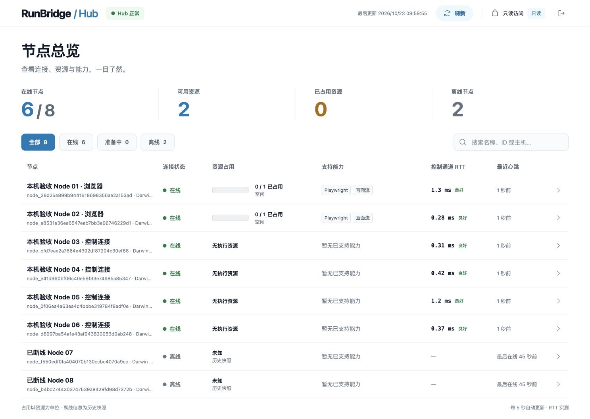
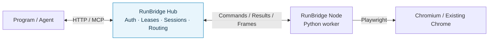

# RunBridge Hub

**Give programs and agents access to browsers on remote devices through HTTP / MCP.**

[简体中文](README.md) · English · [Quick start](#quick-start) · [Documentation](doc/README.en.md) · [Changelog (Chinese)](doc/project/版本发布记录.md) · [Issues](https://github.com/Pegasus-Yang/Run-Bridge-Hub/issues)

[](pyproject.toml) [](LICENSE)

RunBridge Hub is the server component of RunBridge. It accepts connections from [RunBridge Node](https://github.com/Pegasus-Yang/Run-Bridge-Node/blob/main/README.en.md), allocates exclusive device leases, manages browser sessions, and routes commands and results. Clients use HTTP or MCP without connecting directly to the Node's browser port.

Use it for automation programs, agent tools, and test teams that need to share browser devices. Browsers, Playwright, and page objects stay on Node devices; Hub itself needs only a Python environment.

## Highlights

| Capability | What you can do |
| --- | --- |
| Shared HTTP and MCP entry | Use the same authorization, sessions, and execution flow from programs and agents |
| Remote browser operations | Let Nodes connect to Hub and access their browsers through one gateway |
| Exclusive Node leases | Claim, renew, and release an entire Node; reclaim expired or idle leases without overlapping ownership |
| Queryable results | Deduplicate requests and recover their original status after timeouts or disconnections |
| Page streaming | Observe the same page being operated on using frames captured by Node |
| Read-only dashboard | Search and filter devices; inspect connections, occupancy, capabilities, heartbeats, and measured control-channel RTT |

## Screenshots

The dashboard brings device connections, resource occupancy, and capabilities together, on desktop and mobile. Open a node for details. Dashboard access uses its own read-only token.



This screenshot shows a local acceptance environment at the time of capture, using the Chinese UI. Your dashboard displays the connected Hub's actual state. See the [dashboard guide](doc/user-guide/节点总览.en.md) for field definitions.

## How it works



Deploy Hub and Node separately: Hub provides the service entry, and Node executes on the browser device. Each has its own configuration, identity, and runtime environment.

## Quick start

### 1. Install Hub

On the **Hub machine**, prepare Git, Python **3.14.x**, and [uv](https://docs.astral.sh/uv/getting-started/installation/). These commands use a macOS / Linux shell:

```bash
git clone https://github.com/Pegasus-Yang/Run-Bridge-Hub.git
cd Run-Bridge-Hub
uv sync --locked --no-dev -i http://mirrors.aliyun.com/pypi/simple/ --trusted-host mirrors.aliyun.com
.venv/bin/runbridge-hub generate-token --output .runbridge/enrollment.token
.venv/bin/runbridge-hub generate-token --output .runbridge/hub.token
```

`uv` creates `.venv` at the repository root. The two credentials serve different roles: **Node enrollment** and **client claims**. For installation from a wheel in a separate directory, see [deployment](doc/deployment/部署与运行.en.md).

### 2. Save configuration and start Hub

Create `hub.yaml` at the repository root. Replace `public_url` with the **Hub base URL reachable from both Node and clients**:

```yaml
host: 0.0.0.0
enrollment_token_file: .runbridge/enrollment.token
hub_token_file: .runbridge/hub.token
public_url: http://hub.example:8787
```

```bash
.venv/bin/runbridge-hub serve --settings hub.yaml
```

Leave that terminal running and check from another terminal:

```bash
curl --fail http://127.0.0.1:8787/health
```

Expect `{"status":"ok","protocol_version":2}`. Open the `Dashboard URL` from the startup log. An empty list is normal before devices enroll. Keep credential files and dashboard links containing the read-only token private.

For agents or MCP clients, install the optional dependency:

```bash
uv sync --locked --no-dev --extra mcp -i http://mirrors.aliyun.com/pypi/simple/ --trusted-host mirrors.aliyun.com
```

Add `mcp_enabled: true` to `hub.yaml` and restart. Agents connect using Streamable HTTP at the actual Hub base URL plus `/mcp`. See [MCP integration](doc/user-guide/MCP浏览器接入.en.md) for authentication and tool usage.

### 3. Connect Node and verify a browser operation

Privately give the Hub URL and original `enrollment.token` to the device maintainer, who follows the [Node quick start](https://github.com/Pegasus-Yang/Run-Bridge-Node/blob/main/README.en.md#quick-start). Separately provide `hub.token` to the client. Follow the [client guide](doc/user-guide/调用方对接与使用.en.md) to claim Node and save the returned configuration as `.runbridge/access.json`.

From this repository, run the standard-library example to open a page, read its title, save a PNG, close the browser session, and return Node:

```bash
.venv/bin/python doc/reference/examples/执行会话调用.py --access-file .runbridge/access.json --resource-id chromium --url https://example.com --screenshot .runbridge/page.png
.venv/bin/python doc/reference/examples/node_lease.py release --access-file .runbridge/access.json
```

Use the actual resource ID advertised by Node. The URL must be reachable from the **Node device**. Check the screenshot, `cleanup=COMPLETE`, and lease state `RELEASED`. The [quick-start guide](doc/user-guide/快速开始.en.md) includes a complete check using Hub's own health page instead of an external website.

## Supported scope

- Current Hub: **0.9.2**, paired with Node **0.8.1**. Python **3.14.x** is required. Hub does not need browsers, Playwright, or Node.js installed.
- **33 project methods and 27 MCP tools** are available. The interface borrows Playwright naming; the [method reference](doc/reference/Playwright方法表.en.md) defines the supported subset. Direct official SDK connections, arbitrary scripts, and SDK callbacks are outside this interface.
- Managed browsers support HTTP / MCP; borrowed Chrome uses HTTP. Frames provide observation; clients verify the business outcome.
- Browser sessions and Node leases are released separately. Return Node after the batch even when the browser is closed. Unknown cleanup keeps the resource quarantined; see [leases](doc/reference/Node使用权租约接口.en.md).
- Dashboard labels and some CLI messages remain Chinese. English documentation does not change runtime language.

## Documentation and help

| Start here | Contents |
| --- | --- |
| [Documentation index](doc/README.en.md) | Reading paths for deployers, clients, and maintainers |
| [Quick start](doc/user-guide/快速开始.en.md) · [Deployment](doc/deployment/部署与运行.en.md) | Installation, configuration, startup, checks, handoff, and backups |
| [Parameters](doc/reference/参数详解.en.md) · [Annotated YAML](doc/reference/examples/Hub启动配置.en.yaml) | Options, defaults, paths, and deployment scenarios |
| [Client guide](doc/user-guide/调用方对接与使用.en.md) · [Lease API](doc/reference/Node使用权租约接口.en.md) | Claim devices, operate pages, query results, and release resources |
| [MCP integration](doc/user-guide/MCP浏览器接入.en.md) · [DSH integration](doc/user-guide/DSH-Test-Plugin对接指南.en.md) | Agent tools, plugin settings, and batch lifecycle |
| [Page streaming](doc/user-guide/浏览器画面流接入.en.md) · [Dashboard](doc/user-guide/节点总览.en.md) | Observe pages and devices |
| [Operations and troubleshooting](doc/deployment/运行与排障.en.md) | Errors, upgrades, unknown cleanup, and offline review |

## Development and contributions

Use [Issues](https://github.com/Pegasus-Yang/Run-Bridge-Hub/issues) or submit a Pull Request. Include both component versions, environment, reproduction steps, and redacted error details.

Development uses the root `.venv`. The [contribution guide](CONTRIBUTING.en.md) explains setup and validation and links to the detailed development manual in Chinese. Maintained by [Pegasus-Yang](https://github.com/Pegasus-Yang).

## License

This project uses the [MIT License](LICENSE). Bundled [Phosphor Icons](https://github.com/phosphor-icons/core) retain their [original MIT license](src/runbridge_hub/web/icons/LICENSE) and copyright notice. Other dependencies keep their respective licenses.
