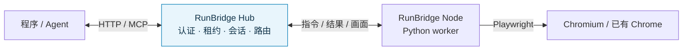

# RunBridge Hub

**通过 HTTP / MCP，让程序和 Agent 使用远程设备上的浏览器。**

简体中文 · [English](README.en.md) · [快速开始](#快速开始) · [完整文档](doc/README.md) · [更新日志](doc/project/版本发布记录.md) · [问题反馈](https://github.com/Pegasus-Yang/Run-Bridge-Hub/issues)

[](pyproject.toml) [](LICENSE)

RunBridge Hub 是 RunBridge 的服务端。它接纳浏览器设备上的 [RunBridge Node](https://github.com/Pegasus-Yang/Run-Bridge-Node)，统一分配设备使用权、管理浏览器会话并转发操作结果。调用方通过 HTTP 或 MCP 使用远程浏览器，无需直接连接 Node 的浏览器端口。

适合自动化程序、Agent 工具接入，以及需要集中分配浏览器设备的测试团队。浏览器、Playwright 和页面对象留在 Node 设备，Hub 自身只需 Python 环境。

## 功能亮点

| 能力 | 可以做什么 |
| --- | --- |
| HTTP 与 MCP 统一入口 | 程序和 Agent 共用认证、会话与执行流程 |
| 跨设备浏览器操作 | Node 主动连接 Hub，调用方经由统一入口使用设备 |
| Node 独占租约 | 领取、续租和释放整个 Node，到期或闲置后回收，避免任务抢占同一设备 |
| 可查询的执行结果 | 按请求 ID 去重并查询原结果，处理超时和断线，避免重复提交动作 |
| 页面画面流 | 转发 Node 采集的同一页面画面，观察远程执行过程 |
| 只读节点总览 | 搜索和筛选节点，查看连接、资源占用、支持能力、心跳与实测控制通道 RTT |

## 实际效果

节点总览将设备连接、资源占用和能力放在同一页面，支持桌面与手机。点击节点可查看详情；总览使用独立只读口令。


截图来自本地验收场景，展示当时的数据。运行后的总览显示所连接 Hub 的实际状态；字段含义见[节点总览指南](doc/user-guide/节点总览.md)。

## 工作方式



Hub 与 Node 分别部署：Hub 提供服务入口，Node 在浏览器所在设备执行。两者的配置、身份与运行环境各自独立。

## 快速开始

### 1. 安装 Hub

在 **Hub 机器**准备 Git、Python **3.14.x** 和 [uv](https://docs.astral.sh/uv/getting-started/installation/)。以下命令使用 macOS / Linux shell：

```bash
git clone https://github.com/Pegasus-Yang/Run-Bridge-Hub.git
cd Run-Bridge-Hub
uv sync --locked --no-dev -i http://mirrors.aliyun.com/pypi/simple/ --trusted-host mirrors.aliyun.com
.venv/bin/runbridge-hub generate-token --output .runbridge/enrollment.token
.venv/bin/runbridge-hub generate-token --output .runbridge/hub.token
```

`uv` 在仓库根目录创建 `.venv`。两份凭据分别供 **Node 登记**和**调用方领取 Node**使用。已有 wheel 的独立目录安装方法见[部署与运行](doc/deployment/部署与运行.md)。

### 2. 保存配置并启动

在仓库根目录创建 `hub.yaml`，将 `public_url` 换成 **Node 与调用方实际可达的 Hub 基址**：

```yaml
host: 0.0.0.0
enrollment_token_file: .runbridge/enrollment.token
hub_token_file: .runbridge/hub.token
public_url: http://hub.example:8787
```

```bash
.venv/bin/runbridge-hub serve --settings hub.yaml
```

保留此终端，另开终端检查：

```bash
curl --fail http://127.0.0.1:8787/health
```

预期返回 `{"status":"ok","protocol_version":2}`。点击启动日志的 `Dashboard URL` 可打开节点总览；尚未登记设备时列表为空。凭据文件和包含只读口令的总览链接应妥善保管。

Agent/MCP 按需安装可选依赖：

```bash
uv sync --locked --no-dev --extra mcp -i http://mirrors.aliyun.com/pypi/simple/ --trusted-host mirrors.aliyun.com
```

在 `hub.yaml` 增加 `mcp_enabled: true` 后重启。Agent 使用 Streamable HTTP 连接实际 Hub 基址后的 `/mcp`；连接参数与调用步骤见 [MCP 接入](doc/user-guide/MCP浏览器接入.md)。

### 3. 接入 Node，验证浏览器操作

将 Hub 基址与真实 `enrollment.token` 私密交给设备维护者，按 [Node 快速开始](https://github.com/Pegasus-Yang/Run-Bridge-Node#快速开始)上线设备。另向调用方提供独立 `hub.token`，按[调用方教程](doc/user-guide/调用方对接与使用.md)领取 Node，保存返回的 `.runbridge/access.json`。

在本仓库可运行标准库示例，打开网页、读取标题、保存 PNG、关闭会话并交还 Node：

```bash
.venv/bin/python doc/reference/examples/执行会话调用.py --access-file .runbridge/access.json --resource-id chromium --url https://example.com --screenshot .runbridge/page.png
.venv/bin/python doc/reference/examples/node_lease.py release --access-file .runbridge/access.json
```

资源 ID 使用 Node 实际上报的值，目标网页需由 **Node 设备**访问。核对截图内容、`cleanup=COMPLETE` 与租约 `RELEASED`。完整步骤与不依赖外部网站的示例见[快速开始](doc/user-guide/快速开始.md)。

## 支持范围

- 当前 Hub **0.9.2**，配套 Node **0.8.1**，需要 Python **3.14.x**；Hub 无需安装浏览器、Playwright 或 Node.js。
- 提供 **33 项项目方法、27 个 MCP 工具**。调用方式借鉴 Playwright，具体支持以[方法表](doc/reference/Playwright方法表.md)为准；官方 SDK 直连、任意脚本和 SDK 回调不在当前范围内。
- managed 浏览器支持 HTTP / MCP，borrowed Chrome 通过 HTTP 使用；页面画面用于观察，业务结果由调用方验证。
- 浏览器会话与 Node 租约分别释放。关闭浏览器后，整批任务结束还需交还 Node；清理未知时保持隔离，见[租约接口](doc/reference/Node使用权租约接口.md)。

## 文档与帮助

| 从这里开始 | 内容 |
| --- | --- |
| [完整文档导航](doc/README.md) | 按部署者、调用方和维护者划分的阅读路线，含英文入口 |
| [快速开始](doc/user-guide/快速开始.md) · [部署与运行](doc/deployment/部署与运行.md) | 安装、配置、启动、验证、交付和备份 |
| [参数详解](doc/reference/参数详解.md) · [注释 YAML](doc/reference/examples/Hub启动配置.yaml) | 参数、默认值、路径规则与使用场景 |
| [调用方教程](doc/user-guide/调用方对接与使用.md) · [租约接口](doc/reference/Node使用权租约接口.md) | 领取设备、操作页面、查询结果和交还资源 |
| [MCP 接入](doc/user-guide/MCP浏览器接入.md) · [DSH 插件对接](doc/user-guide/DSH-Test-Plugin对接指南.md) | Agent 工具、插件配置与整批任务生命周期 |
| [页面画面](doc/user-guide/浏览器画面流接入.md) · [节点总览](doc/user-guide/节点总览.md) | 观察页面和设备状态 |
| [运行与排障](doc/deployment/运行与排障.md) | 常见错误、升级、清理未知和离线核查 |

## 开发与贡献

欢迎通过 [Issues](https://github.com/Pegasus-Yang/Run-Bridge-Hub/issues) 反馈或提交 Pull Request。请附上两端版本、运行环境、复现步骤和已隐藏秘密的错误信息。

源码开发使用根目录 `.venv`，依赖同步、pytest 与隔离联调见[本地开发与联调](doc/development/本地开发与联调.md)；提交范围与验证要求见[贡献指南](CONTRIBUTING.md)。项目由 [Pegasus-Yang（天马）](https://github.com/Pegasus-Yang)维护。

## 许可证

本项目采用 [MIT License](LICENSE)。随 Hub 分发的 [Phosphor Icons](https://github.com/phosphor-icons/core) 保留其[原始 MIT 许可证](src/runbridge_hub/web/icons/LICENSE)与版权声明，其他第三方依赖遵循各自的许可证。
