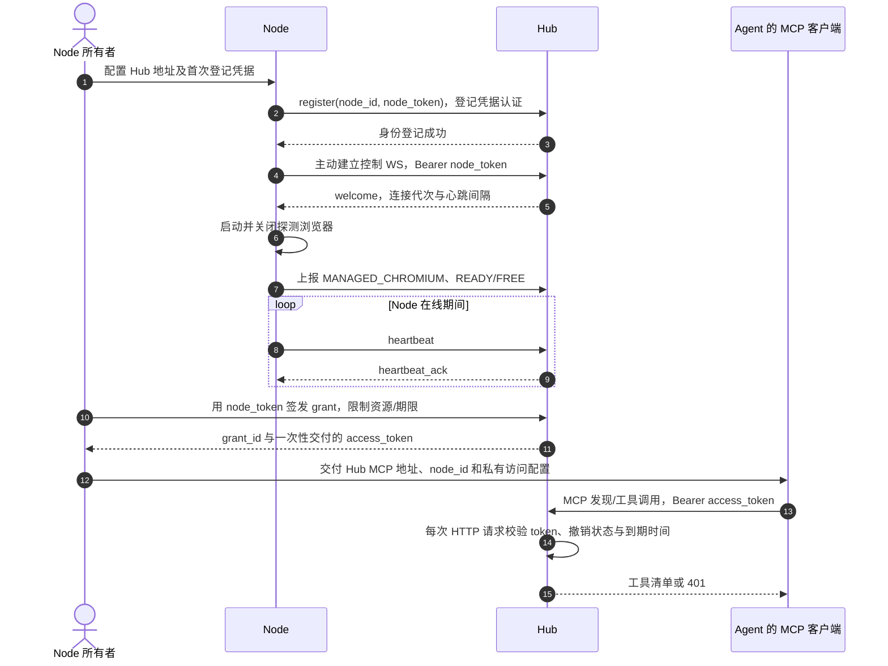
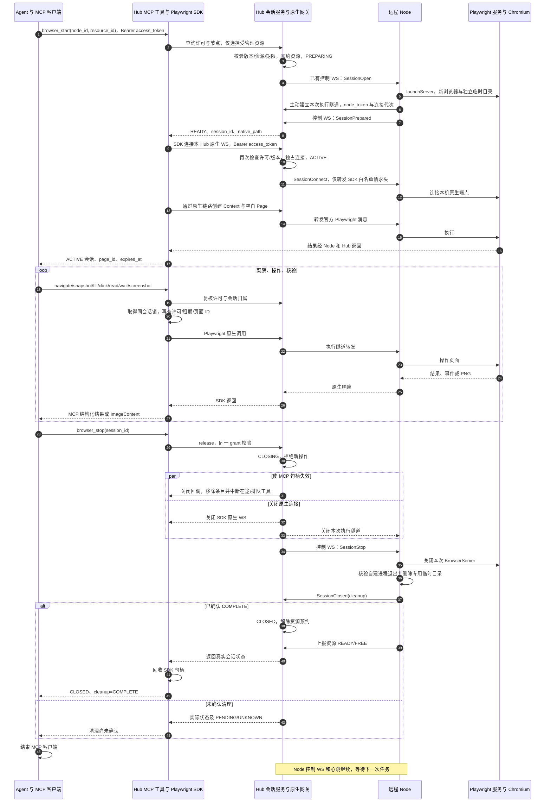

# MCP 授权与浏览器生命周期

[文档导航](../README.md) · [使用与工具合同](../user-guide/MCP浏览器接入.md) · [原生会话架构](Playwright执行与会话管理.md)

本文描述当前实现：Agent 通过 Hub 的 MCP 工具操作 Node 新建的受管理 Chromium。`mcp_server.py` 提供传输与工具，`browser.py` 持有 SDK 对象，现有 `SessionService` 继续负责授权、预约、租期和清理。Node 的 0.4.0 协议和受管理执行器不需要改动。

## 1. 凭据与授权建立

`node_id` 是标识，不是凭据。`node_token` 只用于 Node 身份及所有者管理；Agent 使用独立的 `access_token`。令牌由请求上下文传递给工具，不保存在浏览器注册表，也不作为工具参数公开。每个 grant 绑定一个 Node，可以进一步限制资源与到期时间。

MCP HTTP 层先验证 token 有效性；具体工具再验证节点、资源、会话所属 grant。相同 Node 上的不同 grant 不能互相查询或释放会话。一个会话内的页面操作串行排队，取得锁后再次检查许可、状态、租期和页面归属。

## 2. 从启动到正常释放的完整时序

Hub 内部的 SDK 连接使用部署配置 `mcp_native_url`，不从外部请求 Host 推导。SDK 发到 Hub 的 `access_token` 不会转发到 Node 本机 Playwright 服务，也不会附加到浏览器访问网站的请求中。

同一浏览器的 Context、Page 在多个 MCP 请求间持续存在。`browser_status` 可列出自动登记的新页面 ID，页面关闭或会话结束时句柄失效。MCP 的传输标识与这些业务 ID 无关。

关闭回调同时保留原有画面扩展清理和新增 MCP 清理；没有覆盖原来的 `visual.close`。回调不等待页面操作锁。SDK `browser.close()` 的对象回收延后到 Node 清理报告或超时之后，避免与隧道关闭竞争；它不是清理确认的来源。

## 3. 异常和恢复边界

| 事件 | 当前行为 |
| --- | --- |
| token 缺失、错误、到期、撤销 | MCP HTTP 401，工具不执行；`node_token` 不被接受 |
| 启动时资源忙、离线、未就绪或版本不匹配 | 由现有会话校验拒绝，不绕过预约 |
| 申请成功但 SDK 连接或 Context 创建失败/取消 | 请求会话失败清理，移除 MCP 条目；不将半启动浏览器遗留为可用会话 |
| 页面调用超时 | 返回公开错误码；写动作进入执行阶段后保守标记 `OUTCOME_UNKNOWN`，不自动重放 |
| 显式停止或 grant 撤销 | 无需取得工具锁，中断在途和排队调用，走同一 Node 清理流程 |
| MCP HTTP 客户端退出 | 不立即释放业务会话；同 grant 可重连查询，租期仍生效 |
| 浏览器租期到期 | Hub 维护任务关闭会话；租期最多 3600 秒并受 grant 到期限制 |
| Node 控制断线/进程退出 | 原会话中断，MCP 句柄失效；未收到清理确认时保留 UNKNOWN |
| Hub 重启 | 持久未完成会话标记 INTERRUPTED/UNKNOWN，不恢复原生对象；重新建立新会话 |
| 清理失败或没有确认 | 不伪造 COMPLETE；在线节点的未确认资源继续受预约或 Node 隔离保护 |

`browser_stop` 在发起关闭后等待清理报告最多 10 秒；原生连接关闭也有独立超时，因此总调用时间不承诺恰好 10 秒。浏览器准备最多等待 30 秒，之后 MCP 建立连接和 Context/Page 总计限时 20 秒；失败回收还有清理等待。客户端应为启动/停止保留足够的请求超时，例如 75 秒。

## 4. 什么算“完成”

| 判断 | 证据 |
| --- | --- |
| 授权成功 | 合法访问许可通过 HTTP 校验，工具通过节点/会话范围检查 |
| 浏览器可操作 | `browser_start` 返回 ACTIVE 和有效页面 ID |
| 动作完成 | SDK 调用成功；`completed=true` 不等于业务 PASS |
| 业务成功 | 页面可见结果与业务系统实际状态满足预期 |
| 浏览器已释放 | Node 上报 COMPLETE；实际验收还检查拥有的进程退出、临时目录清除及资源 FREE |
| Agent 本次任务断开 | 先释放浏览器，再结束 MCP 客户端；Node 的长期控制连接继续在线 |

本轮实测使用同一台 macOS 主机的独立 Hub/Node 进程和回环 HTTP/WebSocket。它验证完整协议链路；公网反向代理、跨机器 MCP 和不同 Agent 产品的 UI 配置兼容性尚未重新验收。
