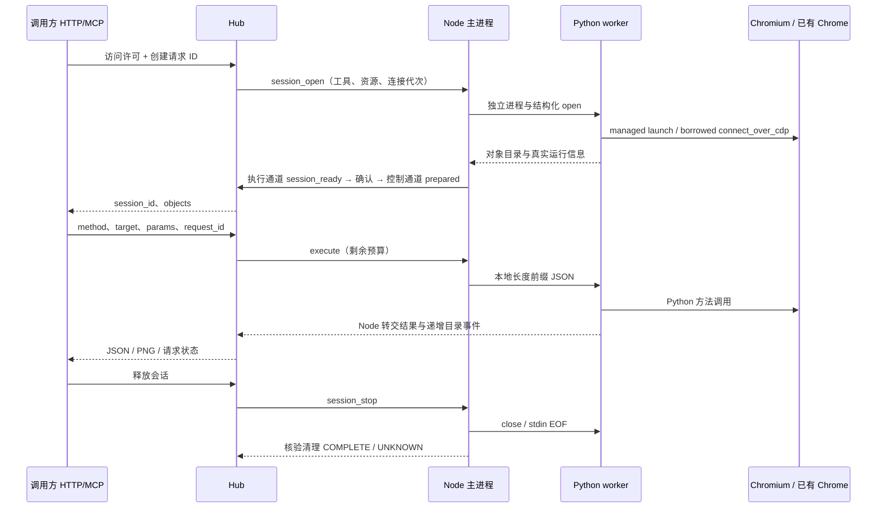

# 工具执行与会话管理

当前架构适用于 Hub/Node 0.6.0。Hub 负责身份、许可、资源独占、租期、方法静态校验、请求去重/排队、路由、结果查询和画面分发。Node 的每会话 Python worker 持有实际 Browser/Context/Page，使用 Python Playwright 执行动作。Hub 和调用方无需 Playwright。

执行通道为 `/v2/nodes/{node_id}/sessions/{session_id}/execution`，Node 主动出站连接；控制为 `/v2/nodes/{node_id}/control`。没有 BrowserServer、SDK 原生入口或 Hub 到自己的浏览器连接。Node 与 worker 使用匿名管道，不暴露本机 Playwright WebSocket。

同一资源只有一个活动会话；会话中动作顺序执行，最多 16 项等待。每次下发复查许可和剩余租期。按 grant/session/request 关联结果，同 ID 不重放。HTTP/MCP 等待与内部动作分离，外部断线不取消正在执行的库调用；到期、撤销、失联及显式释放进入独立关闭流程。

SQLite schema 4 保留节点、许可、版本化会话、启动请求和命令元数据。上传/页面参数/图片不落库。结果使用有界内存缓存；重启未确认动作变为 UNKNOWN，旧会话 INTERRUPTED。旧协议会话历史保留 protocol_version=1，不被当作 v2 已执行证据。

Node 对象归属、PID/Profile 与实际释放由 Node 负责；Hub 不根据 Python 进程消失推断浏览器已清理。UNKNOWN 不释放为 FREE，新的连接代次只在 Node 已核验并报告 FREE 后解除旧占用。

扩展工具通过明确方法声明和本机适配器完成；共享信封、资源独占、鉴权和请求状态服务不依赖 Playwright 对象。当前只实现 playwright，不提供动态代码执行、远程插件加载或官方 SDK 的全部 API。合同详见[工具协议](../reference/工具调用协议.md)。
