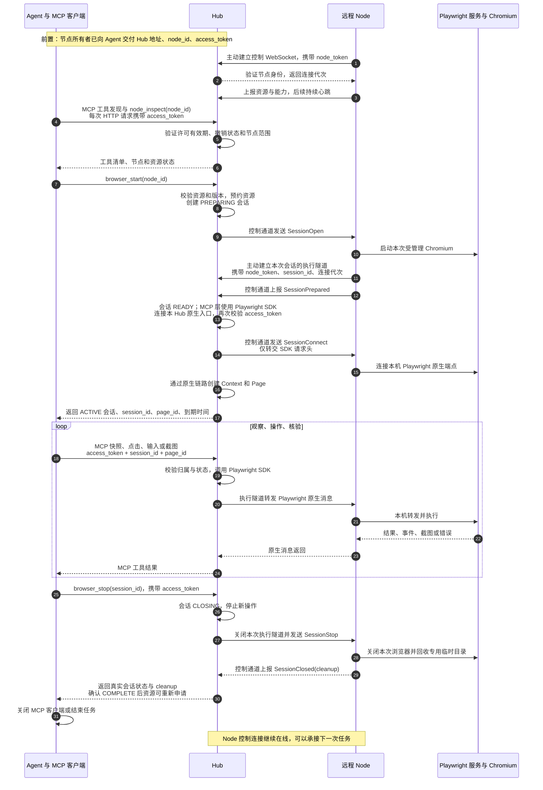
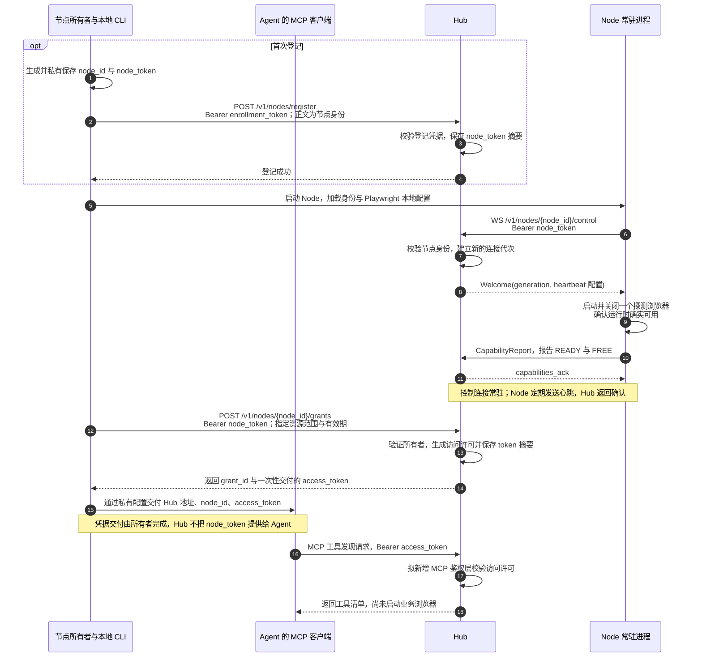
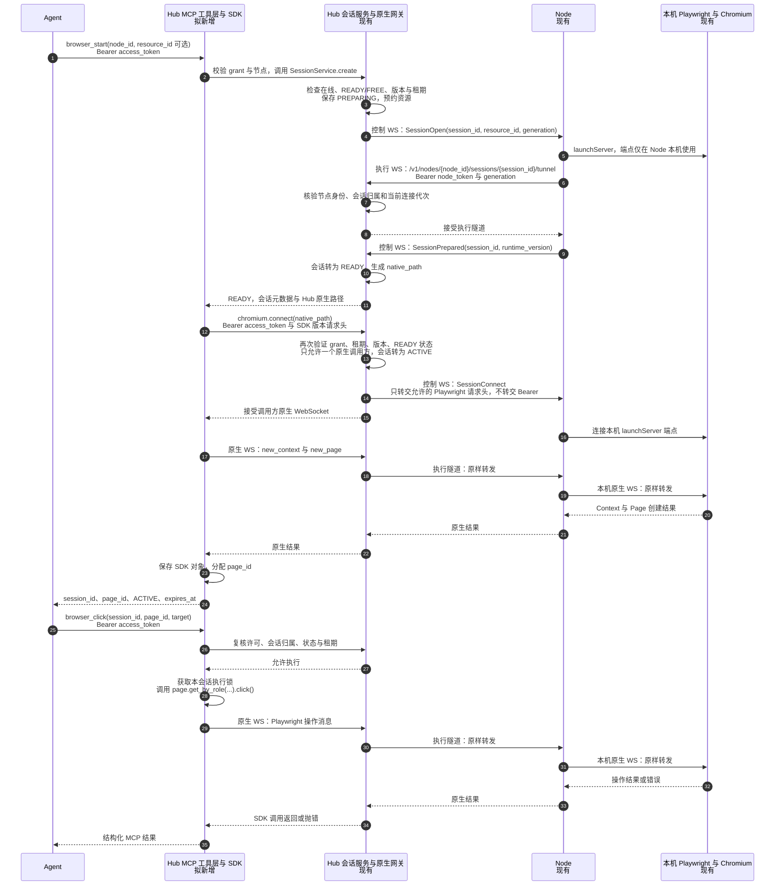
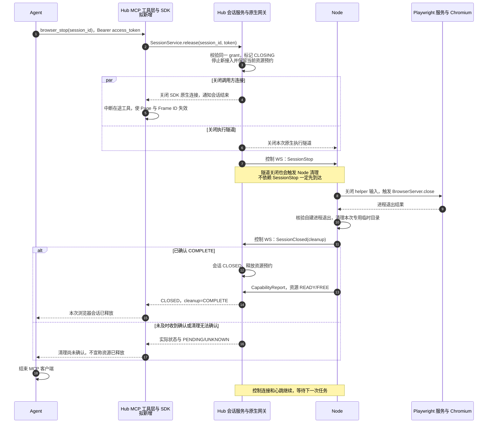
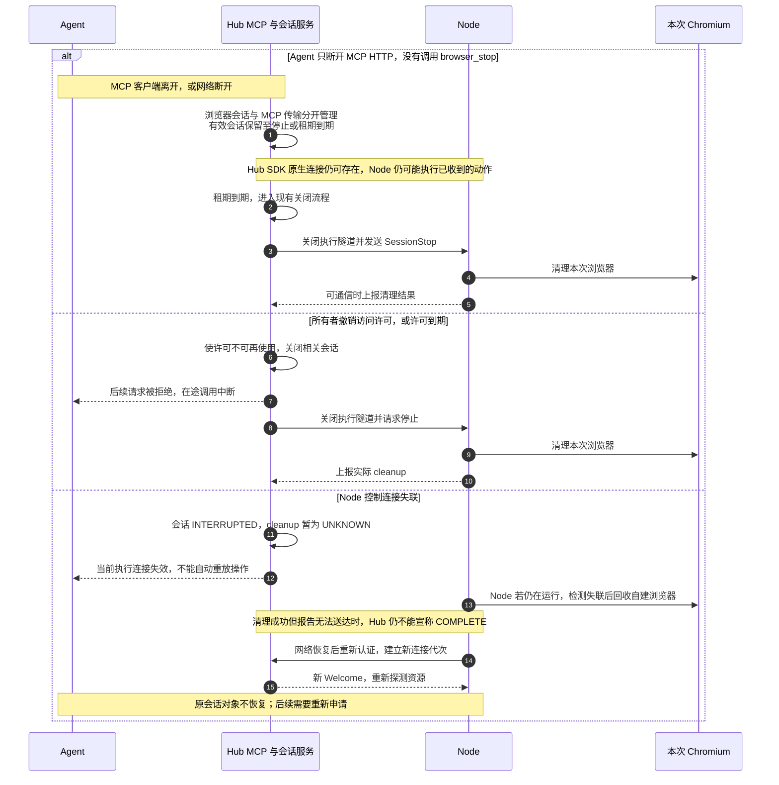

> 历史方案：描述 0.5.x 或更早阶段，保留当时决策语境。当前 0.6.0 已改用 Python worker；请从[当前文档导航](../README.md)操作，不照本文旧命令部署。

# Agent 通过 Hub 控制 Node 的 MCP 运行时序

> 实施状态（2026-10-13）：这是实施前的详细时序设计，原文保留。当前闭环已实现；包含本次实际关闭顺序与异常处理的图见 [MCP 授权与浏览器生命周期](../architecture/MCP授权与浏览器生命周期.md)，验证范围见 [验收记录](../project/MCP浏览器闭环验收记录.md)。

[文档导航](../README.md) · [MCP 实现方案](Hub的MCP浏览器自动化实现方案.md) · [当前执行架构](../architecture/Playwright执行与会话管理.md)

本文描述上一轮方案中的**新建受管理 Chromium** 路线：Agent 通过 MCP 调用 Hub，Hub 内的 Playwright 客户端经现有隧道操作 Node 浏览器。**MCP 层和 Hub 内的 Playwright 客户端尚未实施；节点登记、许可、控制连接、浏览器启动、原生隧道与清理来自当前 0.4.0 实现。**

先看总览，再看授权、执行和关闭细节。图中的凭据均为名称，不是实际秘密。图中的 Agent 包含负责保管凭据和发起 HTTP 请求的 MCP 客户端；模型本身不必看到 token。

## 1. 从连接到断开的完整总览

这张图里有两个不同方向的“连接”：**Node 主动连接 Hub，让自己成为可调度节点；Agent 连接 Hub，申请和使用获授权的执行会话。** Hub 发给 Node 的命令沿 Node 已建立的连接返回，不要求 Hub 主动访问 Node 的公网端口。

总览将 Hub 内部折叠为一个参与者。后面的执行图展开 MCP 工具层和原生网关，避免误以为 MCP JSON 直接送入浏览器。

## 2. 授权从哪里来

### 2.1 三类凭据各自负责什么

| 内容 | 持有方与用途 | Agent 是否需要 |
| --- | --- | --- |
| `enrollment_token` | Hub 部署方配置，首次节点登记时使用 | 不需要 |
| `node_token` | 节点所有者及 Node 私有保存，用于节点控制连接、执行隧道和许可管理 | 不需要 |
| `access_token` | Hub 签发给指定节点的访问许可，可限制资源和到期时间 | MCP 客户端需要，通过 HTTP 头发送 |
| `node_id` | 稳定的节点标识 | 需要；它不是凭据 |
| `grant_id` | Hub 的许可记录标识 | 便于查询或撤销；它不是凭据 |
| `session_id` | 本次浏览器执行会话标识 | 启动后返回；它不是凭据 |

`access_token` 绑定一个 grant，grant 决定节点、资源范围和有效期。仅知道 `node_id` 或 `session_id` 不能获得控制权。同一节点的另一份 grant 也不能接管这次会话。

| 检查位置 | 主要拒绝条件 | 拒绝后的行为 |
| --- | --- | --- |
| Node 控制连接和会话隧道 | 节点身份错误，或隧道代次/归属不匹配 | 拒绝连接，不建立可执行路由 |
| MCP HTTP 请求 | token 无效、到期或撤销 | 拟新增入口返回 401，工具不执行 |
| 节点、资源和会话访问 | 超出 grant 范围，或会话由另一 grant 创建 | 返回相应权限错误，不向 Node 发出本次操作 |
| 创建执行会话 | 节点离线、资源未就绪/占用、SDK 版本不匹配 | 返回具体错误，不能仅凭持有 token 强行启动 |

### 2.2 首次登记、节点上线和许可交付

Node 上线时的启动/关闭是现有就绪探测；Agent 申请执行会话时会再创建新的业务浏览器。许可可以事先签发，图中顺序用于完整说明，不要求每次任务都重新登记节点或创建许可。

## 3. 启动与操作在 Hub 内如何流转

图中 M 与 H 都在 Hub 进程内。B 合并表示 Node 机器上的 Node.js Playwright 服务和它创建的 Chromium。

一次会话内的 Browser、Context、Page 会持续保留，后续点击、输入和截图复用这些对象，不会每次工具调用重新启动或重新连接浏览器。网页请求使用 Node 的网络；截图从浏览器经原生隧道返回 Hub，再作为 MCP 图片内容交给 Agent。

MCP HTTP 层每次请求重新校验 token；原生 WebSocket 在建立时验证一次身份，随后依靠会话状态、期限和撤销关闭进行约束。Hub 不会把 `access_token` 转发到 Node 本机 Playwright 服务或被访问的网页。

| 连接 | 建立方与用途 | 正常任务结束时 |
| --- | --- | --- |
| Agent → Hub MCP HTTP | Agent 客户端调用工具，逐请求携带 `access_token` | 停止浏览器后结束客户端即可 |
| Node → Hub 控制 WebSocket | Node 主动建立，使用 `node_token`；承载心跳和准备/停止消息 | 保留，Node 继续在线 |
| Node → Hub 会话执行 WebSocket | Node 为本次会话主动建立，使用 `node_token` 与连接代次 | 关闭 |
| Hub SDK → Hub 原生 WebSocket | 拟新增 MCP 层使用 `access_token` 建立 | 关闭 |
| Node → 本机 Playwright WebSocket | Node 连接固定本机会话端点，转发官方协议 | 关闭 |

## 4. 正常结束时如何确认已经断开

现有释放操作在发起关闭后等待清理报告，等待上限为 10 秒；关闭连接本身也有等待时间。超时必须读取实际返回状态，不能承诺整个停止调用一定在 10 秒内结束。重复释放是幂等操作。

`cleanup=COMPLETE` 在本图的受管理模式中表示自建浏览器进程和专用临时目录已确认回收。它不表示业务测试通过，也不表示整个 Node 服务退出。

## 5. 未按正常顺序结束时

具体边界：

- MCP 工具尚在执行时收到取消，拟新增工具层取消等待；已发出的页面操作可能生效，需通过后续观察确认，不能承诺回滚。启动阶段取消则进入启动失败清理路径。
- Hub 内的 Playwright **原生连接**断开时，当前网关会关闭本次会话；这与 Agent 的 **MCP HTTP** 连接断开不同。
- 所有者的撤销接口返回表示撤销和关闭已发起，不表示 Node 清理报告已经收到。
- Hub 重启后，未终止的历史会话按现有逻辑标为 `INTERRUPTED/UNKNOWN`，不恢复原生对象或重放操作。已经终止的历史记录保持原状态。
- 如果 Node 进程被强杀，不能假设它执行了清理代码；以实际进程核验和当前清理状态为准。
- 真正需要让 Node 离线时，由节点所有者另行停止 Node 服务。正常停机先结束当前执行，再关闭控制连接；这不是 Agent 完成一项浏览器任务的默认步骤。

## 6. 当前直接使用 SDK 时的对应关系

当前 0.4.0 没有本文的 MCP 入口。调用方自己运行 Playwright 时，使用同一 `access_token` 调用 `POST /v1/nodes/{node_id}/sessions`，再连接返回的 Hub 原生路径，最后关闭 SDK 并调用 `DELETE /v1/sessions/{session_id}`。

拟新增 MCP 层把这段“申请会话 → 持有 SDK 对象 → 操作 → 释放”的客户端逻辑放到 Hub 内，Agent 使用工具调用完成同一流程。Node 仍然沿现有控制协议和原生隧道工作。

## 7. 当前实现的核对入口

| 时序环节 | 源码 |
| --- | --- |
| 生成并保存节点身份、登记、保存调用许可 | [Node cli.py](../../../runbridge-node/src/runbridge_node/cli.py)、[Node config.py](../../../runbridge-node/src/runbridge_node/config.py) |
| 节点身份验证、许可签发与访问验证 | [Hub service.py](../../src/runbridge_hub/service.py) 的 `register`、`create_grant`、`authorize_access` |
| Node 主动连接、能力与心跳 | [Node client.py](../../../runbridge-node/src/runbridge_node/client.py)、[Hub gateway.py](../../src/runbridge_hub/gateway.py) |
| 会话申请、原生接入、撤销与释放 | [Hub sessions.py](../../src/runbridge_hub/sessions.py) 的 `create`、`attach_caller`、`release`、`revoke` |
| Hub 原生转发与连接断开处理 | [Hub native.py](../../src/runbridge_hub/native.py) 的 `tunnel`、`execute` |
| 浏览器启动、执行隧道与清理报告 | [Node executor.py](../../../runbridge-node/src/runbridge_node/executor.py) 的 `_serve` |
| 进程与专用临时目录回收 | [Node runtime.py](../../../runbridge-node/src/runbridge_node/runtime.py)、历史 `playwright_runtime/server.mjs`（0.6.0 已移除，原内容见 Git 历史） |

本次按本地源码核对时序并补充方案说明，没有启动服务、修改运行代码或执行浏览器验收。
