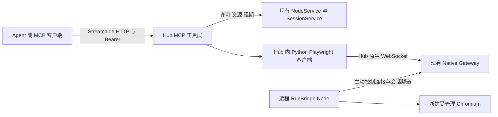

> 历史方案：描述 0.5.x 或更早阶段，保留当时决策语境。当前 0.6.0 已改用 Python worker；请从[当前文档导航](../README.md)操作，不照本文旧命令部署。

# Hub MCP 浏览器自动化实现方案

> 实施状态（2026-10-13）：本文保留实施前方案与取舍。当前已实施新建受管理 Chromium 的 12 工具闭环，实际合同见 [MCP 浏览器接入](../user-guide/MCP浏览器接入.md)，时序见 [当前架构](../architecture/MCP授权与浏览器生命周期.md)。下文“拟新增/尚未实施”及更完整工具集描述属于原方案，不代表全部已交付。

[文档导航](../README.md) · [当前执行架构](../architecture/Playwright执行与会话管理.md) · [当前会话接口](../reference/会话接口与原生连接.md)

日期：2026-10-13。状态：待评审，尚未实施。基线：本地 Hub 与 Node 均为 0.4.0，Node 受管理浏览器运行时锁定 Playwright 1.63.0。

## 1. 结论与首期范围

**可以实现，现有浏览器执行链路具备较好的复用条件。建议在 Hub 增加可选 MCP 入口，通过官方 Python Playwright SDK 操作 Node 启动的 Chromium。基本操作封装较简单，完整交付的工作量主要来自跨请求对象管理、授权、失败处理和清理。**

用户已确认首期优先启动新的受管理浏览器，暂不复用已有登录。首期目标是：调用方配置 Hub 地址和现有 `access_token`，提供 `node_id`，即可让 Agent 查询资源、启动浏览器、观察页面、执行常用操作并释放会话。

首期范围如下：

- Chromium 网页自动化，包括导航、页面与 iframe 观察、点击、输入、按键、选择、滚动、标签页、JavaScript 弹窗、条件等待和截图。
- 同一会话内可以完成新的登录操作；关闭后不承诺保存登录态。
- Agent 负责理解自然语言、选择工具和判断业务结果；Hub 提供确定性的工具执行，不新增模型调用或自动任务规划器。用户不必预先编写定位器和结构化断言。
- 启动浏览器意味着 Node 已运行、浏览器运行时已准备好；不包含远程安装 Node、唤醒机器或启动离线节点。

已有 Chrome 复用、原生桌面窗口、浏览器地址栏与系统文件选择框、持续画面流、完整文件产物管理、任意脚本执行和并发扩容不纳入首期。网页文件上传可以在后续通过 Playwright 文件接口实现，不必自动点击系统对话框。

## 2. 当前实现可以复用什么

下表是本次源码检查确认的事实。已有测试文件用于定位后续回归点，本次没有重新运行浏览器或跨机器验收。

| 能力 | 当前实现与证据 | 对方案的影响 |
| --- | --- | --- |
| 调用方身份 | [`service.py`](../../src/runbridge_hub/service.py) 的 `authorize_access()` 校验 token、有效期、撤销和节点归属 | 复用 `access_token`，不重新设计账号体系 |
| 资源发现 | `NodeService.query()` 按许可过滤资源，返回在线状态、新鲜度和占用 | 可自动发现唯一获授权的受管理资源 |
| 浏览器会话 | [`sessions.py`](../../src/runbridge_hub/sessions.py) 的 `create()`、`query()`、`release()` | 复用资源独占、租期、状态与清理报告 |
| 原生接入 | [`native.py`](../../src/runbridge_hub/native.py) 提供 `/v1/sessions/{session_id}/playwright` | MCP 层可作为正式 Playwright 调用方接入 |
| Node 启动 Chromium | 历史 `executor.py`、`runtime.py`、`playwright_runtime/server.mjs`，原内容见 Git 历史；最后一项已在 0.6.0 移除 | 当时 Node 已通过 `chromium.launchServer()` 启动并清理自建浏览器 |
| 原生操作与截图 | [`test_playwright.py`](../../../runbridge-node/tests/test_playwright.py) 已有页面、输入、弹窗、新窗口、截图和文件传输测试 | 是后续复用的回归依据，不能等同于 MCP 已验收 |
| 挂载位置 | [`app.py`](../../src/runbridge_hub/app.py) 统一创建 FastAPI、服务对象和 lifespan | 可在现有进程内挂载 MCP ASGI 应用 |
| 可选画面流 | 现有受管理模式说明（由 RunBridge Node 项目维护） 明确不支持独立画面流 | 首期采用 Playwright 单次截图，无需引入 Browscreen |

必须保留的现有约束：

1. 当前 Node 执行器一次只持有一个活动执行，会话独占资源；同一会话只能接入一个原生调用连接。
2. 受管理协议要求 Playwright 客户端与 Node 运行时的主次版本一致；MCP 层的版本来自实际安装包，不能由模型伪造。
3. 会话默认租期 300 秒，上限 3600 秒，并受许可到期时间限制；当前没有续租接口。
4. 断线或重启后不会复活原生对象；清理未确认时保留 `UNKNOWN`，不提前把资源当作空闲。
5. 浏览器启动参数由 Node 所有者本地配置，外部创建会话不能覆盖 `launch_options`。

是否显示浏览器窗口继续取决于 Node 的 `headless` 配置。有界面模式还需要 Node 机器具备可用图形会话；MCP 工具在两种模式下使用相同的页面操作契约。

## 3. 方案比较

| 路线 | 实现方式 | 优点 | 成本与限制 | 建议 |
| --- | --- | --- | --- | --- |
| 只返回原生连接 | MCP 封装资源查询、会话申请，返回 Hub 原生入口 | 新增代码最少 | 调用方还要运行 Playwright；仅支持 MCP 工具的 Agent 无法直接点击和输入 | 可供 SDK 用户使用，不能独立满足本次目标 |
| Hub 内封装常用工具 | Python MCP SDK + Python Playwright SDK，复用 Hub 服务和原生隧道 | 技术栈一致、授权和清理集中、Node 改动少 | 需要维护有限的工具参数、对象注册和结果格式 | **首期推荐** |
| 包装现成 Playwright MCP | Hub 为每个执行会话启动独立 MCP 子进程，将 `remoteEndpoint` 指向 Hub 原生入口 | 已有较完整的快照与浏览器工具 | 新增 Node.js MCP 运行时、子进程和两层 MCP 生命周期，需验证版本、鉴权头、关闭及多调用方隔离 | 大量高级工具成为刚需时再比较 |

微软 Playwright MCP 的公开配置已经支持 Playwright `remoteEndpoint` 及连接请求头，不能把它误判为只能使用 CDP；但这些配置本身不处理 RunBridge 的资源申请和清理。[官方配置说明](https://github.com/microsoft/playwright-mcp#configuration)

推荐路线只封装官方公开 API，不复制 Playwright MCP 的内部实现，也不自行实现浏览器协议。

## 4. 推荐架构

授权、启动、操作、清理和异常断线的完整时序见 [Agent 到 Node 的 MCP 运行时序](Agent到Node的MCP运行时序.md)。其中明确区分 Node 常驻控制连接与每次任务的执行连接。



浏览器进程和网页网络请求发生在 Node 机器；Playwright 客户端对象、MCP 工具和截图响应位于 Hub。Node 的浏览器调试端口继续只供本机使用。

### 4.1 MCP 入口与运行方式

- 对外新增 `/mcp`，采用官方 MCP Python SDK 的 Streamable HTTP ASGI 应用。沿用 Hub 当前单 Worker 部署。
- 新增可选安装项 `runbridge-hub[mcp]`，候选依赖为 `mcp==2.3.0` 与 `playwright==1.63.0`。锁定最终版本前必须完成 Python 3.14、现有 FastAPI/Starlette 组合与真实 MCP 客户端验证。
- 本次查询的 PyPI 元数据中 `mcp` 为 2.3.0，声明支持 Python 3.10 及以上，并包含 Python 3.14 条件依赖；这是包元数据证据，不是本项目安装兼容性测试。[PyPI 元数据](https://pypi.org/pypi/mcp/2.3.0/json)
- 候选 SDK 2.x 使用 `MCPServer`。应按锁定版本开发，不直接套用旧版 `FastMCP` 示例。[2.3.0 官方 SDK](https://github.com/modelcontextprotocol/python-sdk/tree/v2.3.0)
- MCP 默认关闭，安装扩展并显式启用才挂载路由；原安装方式和 HTTP/WebSocket 使用方式继续工作。
- Hub 只需要 Playwright 客户端及其包内驱动，不需要在 Hub 安装或启动 Chromium；浏览器仍由 Node 准备。

挂载时把 MCP session manager 纳入 Hub 的 lifespan；仅 `mount()` 子应用不足以启动其生命周期。需验证 `/health`、`/v1` 和 WebSocket 路由不被挂载顺序遮蔽。[SDK ASGI 挂载说明](https://github.com/modelcontextprotocol/python-sdk/blob/v2.3.0/docs/run/asgi.md)

### 4.2 协议会话与浏览器会话分开

2026-07-28 版 MCP 已移除协议级会话；较旧客户端仍可能使用 `initialize` 与 `Mcp-Session-Id`。让锁定 SDK 处理协议兼容，首期验证新版调用和 2025-11-25 兼容路径。应用自己的浏览器对象注册表必须独立存在，不能把 MCP 会话头作为必要条件或授权凭据。[当前传输规范](https://modelcontextprotocol.io/specification/2026-07-28/basic/transports/streamable-http)、[SDK 版本兼容说明](https://github.com/modelcontextprotocol/python-sdk/blob/v2.3.0/docs/protocol-versions.md)

对旧协议优先采用无状态 HTTP 传输配置；工具不依赖 sampling、客户端 roots 或服务端主动询问。HTTP 响应结束和 SSE 断开不等于浏览器会话结束。浏览器由显式停止、既有租期、许可撤销或执行连接终止负责回收。

## 5. node_id 与 token 的使用契约

已知 Hub 地址后，调用方只需要节点 ID 和现有调用许可；无需接触 Node 本机的浏览器端点。

```text
MCP 地址：https://hub.example.com/mcp
HTTP 认证头：Authorization: Bearer <access_token>

工具调用：node_inspect(node_id="node_example")
工具调用：browser_start(node_id="node_example", lease_seconds=300)
```

以上为拟定接入方式，不是当前可运行命令。MCP 客户端应在私有配置或凭据存储中提供 token，工具参数和模型上下文不重复携带 token。

### 5.1 复用当前授权

1. MCP HTTP 层每次请求都验证 `access_token`，包括工具发现请求。鉴权失败在执行工具前返回 HTTP 401。
2. token 对应的 grant 确定允许的 `node_id` 和 `resource_ids`。工具参数的节点必须属于该 grant。
3. `node_token` 用于 Node 身份和许可管理，登记 token 用于首次登记，两者均不能替代 MCP 的 `access_token`。
4. `resource_id` 可省略的前提是该许可下恰好有一个受管理 Chromium 资源；零个返回明确原因，多个要求指定。资源是否在线、READY/FREE 仍由现有会话服务最终确认。
5. 后续调用校验 `session_id` 的 `grant_id`、节点、会话状态和租期；`page_id`、`frame_id` 必须属于该会话。只有 ID 而没有有效许可不能操作浏览器。
6. 多个客户端共用同一个 token，就共用同一个许可身份，与现有 REST 语义一致。需要调用方隔离时为其分别签发 grant。

传输鉴权可将现有 `authorize_access()` 的 token 解析部分提取为共用小函数，再由原方法继续验证节点归属，避免两套撤销和有效期逻辑。首期采用外围 ASGI 鉴权，不虚构 OAuth issuer 来满足 SDK 配置。

### 5.2 兼容边界

首期是**支持静态 Bearer 请求头的 MCP 客户端接入方式**。标准 OAuth 授权发现还涉及授权服务器、受保护资源元数据、audience 等机制，现有随机访问 token 不能直接宣称已实现这些流程。只支持 OAuth 登录、不能配置静态请求头的客户端不在首期兼容承诺内；实施时选定一个实际使用的客户端完成验收。[MCP 授权规范](https://modelcontextprotocol.io/specification/2026-07-28/basic/authorization)

MCP 和原生接口属于同一个 Hub 的资源授权边界。MCP 层只向配置好的 Hub 内部原生地址发送请求头，不能向调用方指定的地址转发 token；浏览器目标站点和 Node 浏览器进程不接收该 Bearer。生产入口使用 HTTPS，并为 MCP 配置实际允许的 Host/Origin，防止默认仅允许 localhost 导致部署不可用。[SDK 部署说明](https://github.com/modelcontextprotocol/python-sdk/blob/v2.3.0/docs/run/deploy.md)

## 6. 首期工具设计

工具按操作提供明确参数，不增加接受任意 Python/JavaScript 的万能执行工具。节点发现、启动和会话列表按 `node_id` 请求，其余工具携带 `session_id`；页面操作显式携带 `page_id`，iframe 操作可携带 `frame_id`，避免隐藏的“当前页”被并发调用改变。

| 工具 | 主要用途 | 关键约束 |
| --- | --- | --- |
| `node_inspect` | 查询节点和已授权的受管理资源 | 显示在线、新鲜度、版本、占用，不启动浏览器 |
| `browser_start` | 申请会话、连接 SDK、创建独立 context 与首个页面 | 返回 `ACTIVE` 后才表示可以操作 |
| `browser_sessions` | 查询本进程内同一许可创建的 MCP 浏览器会话 | 用于查找启动响应丢失后的活动会话；不承诺重启恢复对象 |
| `browser_status` | 查询会话、到期时间与清理状态 | 保留 Hub 原有状态语义 |
| `browser_stop` | 幂等释放当前浏览器会话 | 返回实际 `cleanup`，不把发出停止命令当作完成 |
| `browser_pages` | 列出、新建、关闭页面 | 新窗口事件自动注册；默认新页为 `about:blank` |
| `browser_frames` | 列出页面 iframe 及对应 ID | frame 脱离后立即失效，不能跨页使用 |
| `browser_navigate` | 打开 URL、后退、前进、刷新 | 首期公开导航仅接受 HTTP/HTTPS；新页使用内部 `about:blank` |
| `browser_snapshot` | 返回页面或 frame 的 ARIA 快照、标题、URL | 支持指定元素子树，限制返回长度并标记截断 |
| `browser_screenshot` | 当前视口或指定元素截图 | 返回 MCP 图片内容，不要求客户端读取 Hub 本地文件 |
| `browser_click` | 单击、双击、右键点击 | 使用唯一定位，不默认 `force` 或自动取第一个 |
| `browser_fill` | 替换输入框内容 | 动作后可读取值核验；不在日志回显输入内容 |
| `browser_type` | 按字符输入 | 用于依赖逐键事件的控件 |
| `browser_press_key` | 按键和组合键 | 支持页面或指定元素，如 Enter、Tab、Control+A |
| `browser_select` | 原生下拉框选择 | 自定义下拉框通过点击等工具操作 |
| `browser_check` | 设置 checkbox/radio 状态 | 使用明确目标状态，避免重复切换 |
| `browser_hover` | 悬停显示菜单等 | 沿用 Playwright 可操作性检查 |
| `browser_scroll` | 滚动视口或让元素进入视口 | 不添加操作系统级鼠标控制 |
| `browser_read` | 读取元素文本、输入值或有限属性 | 供调用方验证实际页面状态 |
| `browser_wait_for` | 等待元素、文本或 URL 条件 | 有限超时，避免把固定 sleep 当成成功判断 |
| `browser_dialog` | 预设下一次 JavaScript 弹窗处理方式 | 先设置 accept/dismiss，再触发；默认 dismiss 并记录消息 |

### 6.1 观察与定位

首期使用公开 ARIA 快照与语义定位：`role + name`、label、text、test id，必要时 CSS。定位字段使用固定结构，不接收任意表达式；要求唯一匹配，不唯一时返回歧义并让 Agent 根据观察进一步缩小范围。可支持一个明确的容器定位，避免无限嵌套的定位语言。

```json
{
  "session_id": "session_example",
  "page_id": "page_example",
  "target": {"by": "role", "role": "button", "name": "提交", "exact": true}
}
```

上述参数由 Agent 从页面观察中生成，不要求业务用户提供。首期不自制 DOM 元素 ID 系统。Playwright 1.63.0 的公开快照已有 AI 模式和引用，但引用跨刷新、跨 frame 的使用契约应另行验证；本方案的基本交付不依赖它。[Playwright 1.63.0 快照 API](https://github.com/microsoft/playwright/blob/v1.63.0/docs/src/api/class-page.md#async-method-pageariasnapshot)

首期普通 DOM 网页最适合该路线。Canvas 游戏、远程桌面画布、关闭的 Shadow DOM 等无法保证通过语义定位完整操作，视觉坐标工具是独立后续范围。

### 6.2 结果与输出

- 成功返回结构化数据和简短文字摘要，带 `session_id`、相关页面 ID、观察时间和操作结果。
- 预期业务或执行错误使用 MCP 工具错误结果，并保留稳定错误码；JSON-RPC 参数错误由 SDK 处理。
- 截图使用 MCP 图片内容；普通截图只保留于当前响应内存，不默认写 Hub 任意路径或建设文件下载服务。
- 文本默认最多返回 20,000 字符并标记 `truncated`；图片设独立大小上限，超限明确要求元素截图或更小视口。具体常量在闭环验证中确定，不预先增加一组用户配置项。
- 首期不承诺上传、下载或 trace 的文件交付接口。原生 SDK 已有的文件能力仍保留，后续 MCP 文件工具必须单独说明 Agent、Hub、Node 三台机器上的路径含义。
- 工具成功表示该操作或等待条件完成；整个业务任务是否成功由调用方依据页面状态或外部系统证据判断。原有 `SessionView.execution_outcome` 不因为某次点击成功就变为业务 PASS。

## 7. 会话执行与清理

### 7.1 启动流程

1. 校验请求凭据、节点和资源，读取 Hub 本地 Playwright 的实际版本。
2. 调用现有 `SessionService.create()`，等待 Node 的 `SessionPrepared` 和原生隧道，使会话达到 `READY`。
3. 通过 `chromium.connect()` 连接 Hub 返回的原生路径，携带同一访问许可。受管理链路使用 Playwright 协议，不切换为 CDP。[官方连接约束](https://github.com/microsoft/playwright/blob/v1.63.0/docs/src/api/class-browsertype.md#async-method-browsertypeconnect)
4. 创建独立 BrowserContext 和首个 Page，注册页面、弹窗与断线事件，确认会话为 `ACTIVE`。
5. 返回 `session_id`、`page_id`、资源和租期信息。Node 本机端点、路径和 token 不进入响应。
6. 创建过程中任意一步失败或取消，都进入统一清理路径；已创建的 Hub 会话不能因 MCP 响应失败而无人处理。

MCP 工具调用不是每次重新 `connect()`。Hub 在生命周期内保留异步 Playwright 驱动，并在内存保存各会话的 Browser、Context、Page 和 Frame 对象。注册表以 Hub `session_id` 为主键，记录 `grant_id` 和节点归属，不保存原始 token。

### 7.2 并发和事件

- 每个浏览器会话串行执行普通工具，避免同一页面导航和输入互相覆盖；不同资源保持独立。等待获得执行锁也计入超时。
- 停止和撤销不能排在一个长时间等待工具后面；先标记关闭并取消在途调用，再执行限时清理。
- 弹窗事件回调立即按已设置策略响应，不能拿着执行锁等待下一次 `browser_dialog`，否则触发弹窗的 click 可能永远无法返回。
- 页面、新窗口和 frame 的 ID 只在所属会话有效；关闭、frame 脱离或连接代次变化后拒绝旧 ID。
- MCP 注册表不能绕过现有资源独占；直接 SDK 调用和 MCP 调用竞争同一个资源时仍返回 `RESOURCE_BUSY`。MCP 持有原生连接期间，不提供第二个原生客户端接管入口。

### 7.3 结束与故障

| 情况 | 处理方式 | 返回与恢复原则 |
| --- | --- | --- |
| 主动停止 | 通过现有释放服务停止 Node 浏览器，失效对象并关闭客户端连接 | 以 Node 清理报告为准；重复停止幂等 |
| 租期或许可到期 | 复用现有会话终止机制，撤销对象和在途调用 | 不自动续租；剩余操作需新申请会话 |
| 许可撤销 | 现有 `SessionService.revoke()` 关闭执行链路 | 新请求拒绝，在途动作可能已生效，不能承诺回滚 |
| HTTP/MCP 连接结束 | 保留有效业务会话至显式停止或租期 | 不能假定客户端总会发送协议会话 DELETE |
| 工具超时或取消 | 取消等待，记录已知状态，允许后续只读核验 | 动作已发送但未收到结果时返回 `OUTCOME_UNKNOWN`，不自动重放点击或提交 |
| Node 断线或 Hub 重启 | 沿用 `INTERRUPTED`、代次隔离与清理语义 | 不恢复页面对象；清理无法确认时保留 `UNKNOWN` |
| 启动响应丢失 | 查询同一许可的 MCP 会话列表和资源状态 | 先查明已创建还是已清理，再决定是否重新启动 |

定位失败、参数错误等确定未执行的情况，应与执行中断导致的结果未知区分。页面等待超时也不自动证明此前业务提交失败。

`sessions.on_close` 当前已经绑定 `visual.close`。增加 MCP 清理时组合两个回调，不能覆盖画面清理；回调必须可重复调用，并避免与停止逻辑相互等待。Hub 正常退出时，先停止接收新 MCP 调用，再释放浏览器、停止驱动，最后关闭现有会话服务、节点连接和数据库。

## 8. 预计改动位置

| 位置 | 计划改动 |
| --- | --- |
| `pyproject.toml`、`uv.lock` | 增加可选 MCP 依赖并锁定；按项目指定源用 uv 管理 |
| `src/runbridge_hub/app.py` | 可选挂载 MCP、组合 lifespan 和既有关闭回调 |
| `src/runbridge_hub/settings.py`、`cli.py` | 增加明确的启用开关及必要的 Host/Origin 配置 |
| `src/runbridge_hub/service.py` | 小范围提取共用访问许可解析，保持 REST 授权行为 |
| 新增 `src/runbridge_hub/mcp_server.py` | MCP 注册、请求上下文和工具结果映射 |
| 新增 `src/runbridge_hub/browser_session.py` | 原生连接、对象注册、锁、事件和关闭 |
| 新增 `src/runbridge_hub/browser_tools.py` | 有限工具参数和 Playwright 调用 |
| 新增 `tests/test_mcp.py`、`tests/test_browser_tools.py` | 传输、授权、隔离与工具行为测试 |
| Hub 与 Node 的真实联调测试 | 从 MCP 入口验证远程启动、操作和清理 |
| 使用、部署、接口文档与导航 | 在实现完成后记录真实安装方式、兼容客户端和限制 |

这些是职责划分，实施时按实际规模保持最少文件数。`SessionService` 只做必要连接，不另建一套会话状态机或数据库表。

Hub 内 Playwright 连接自身原生入口的地址由部署配置确定。标准 CLI 启动时复用已有监听端口并选择可达的本地地址；自定义 ASGI 部署才显式传入可信内部基址。不能根据 MCP 请求的 Host 或工具参数任意拼接带 token 的目标地址。

Node 首期预计无需修改控制协议和浏览器启动实现，仅增加必要联调测试及说明。现有可视流、Chrome 复用与非 MCP 接口纳入回归，不在本轮顺带改造。

## 9. 分阶段实施与验收

以下工作量是单人熟悉代码、已有可用 Node 与测试页面时的工程估算，不是实测承诺。**演示闭环约 1–2 个工作日，包含常用工具和异常验证的首期约 5–8 个工作日。** SDK 集成和实际客户端不兼容可能增加时间。

| 阶段 | 实施内容 | 完成判断 | 预计工作量 |
| --- | --- | --- | --- |
| P0 接通链路 | 可选依赖、ASGI 挂载、静态 token、启动/导航/截图/停止 | 实际 MCP 客户端经 Hub 操作另一进程的 Node，截图含预期页面；释放后浏览器进程退出、资源恢复 FREE | 1–2 天 |
| P1 常用网页工具 | 页面/frame 注册、快照与定位、输入/点击/键盘/选择/滚动/等待/弹窗 | 固定测试页面完成观察、操作与独立结果核验；支持多标签页和 iframe | 2–3 天 |
| P2 异常与交付 | 撤销、租期、取消、断线、授权隔离、版本失败、文档与打包 | 下述异常矩阵通过，旧接口回归通过，跨机器样例可复现 | 2–3 天 |

### 9.1 必须覆盖的验证矩阵

| 验证项 | 输入或场景 | 必须观察到的结果 |
| --- | --- | --- |
| 默认安装兼容 | 未安装或未启用 MCP | Hub 原启动、HTTP 与原生接口保持可用；不强制导入可选包 |
| 新旧 MCP 客户端 | 新版请求与 2025-11-25 兼容调用 | 工具发现、结构化结果、图片和错误可解析，浏览器不依赖 MCP 会话头 |
| HTTP 层鉴权 | 无 token、错误 token、过期、撤销、`node_token` | 执行前拒绝；不能只测绕过 HTTP 的内存 MCP 客户端 |
| 授权隔离 | A 许可访问 B 节点、资源、会话、页面或 frame | 明确拒绝，B 的页面状态不变化 |
| 资源选择 | 唯一资源、多资源、离线、UNAVAILABLE、BUSY | 选择和错误符合公开契约，不自动抢占或启动别的后端 |
| 版本校验 | MCP Playwright 与 Node 主次版本不匹配 | 创建前或接入时明确失败，无持续遗留进程 |
| 页面操作 | 输入、提交、下拉框、复选框、按键 | 读取实际页面值或测试服务端状态验证，不以工具返回成功代替业务效果 |
| 页面与 frame | 新窗口、两个同名按钮、跨源 iframe、frame 移除 | ID 归属正确，重复定位报歧义，失效对象不会作用到另一页面 |
| 弹窗 | accept、dismiss、prompt | 按预设处理，触发动作不因工具锁死等而悬挂 |
| 图片与快照 | 中文页面、大页面、元素截图 | 图片实际可解码；中文可读；内容截断或超限有明确标志 |
| 同会话并发 | 导航与输入同时到达 | 普通操作串行，停止和撤销可及时中断等待 |
| 正常释放 | 主动 stop、重复 stop、租期到期 | Node 自建浏览器退出、临时目录按既有规则清理、资源可重新申请 |
| 取消与结果未知 | 启动取消、点击后断网、响应丢失 | 没有失管会话；不自动重放操作；可以查询技术状态并核验页面效果 |
| 撤销与故障 | 撤销 grant、强杀 Node、Hub 重启 | 原连接失效，旧 ID 不复活，未知清理不伪报 COMPLETE |
| 实际客户端与跨机 | 指定 MCP 客户端 + Hub + 远程 Node | Node 网络内测试页面可访问，截图可展示，退出和再次启动正常 |

在各项目根目录用其 `.venv/` 和 `uv run --locked --no-sync pytest` 执行相应测试。新增浏览器联调使用隔离配置、临时数据库和专用测试页面，真实浏览器测试显式启用；受限运行环境无法启动浏览器时，报告验证边界，不反复盲目启动。

## 10. 评审建议

建议按本方案的 P0 → P1 → P2 实施：首期提供受管理 Chromium 的 MCP 常用工具，复用现有 `access_token`、资源和会话服务；保持 Node 协议不变。先验收“启动 → 观察 → 操作 → 独立核验 → 释放”的完整链路，再扩展高级工具。

完整 OAuth、文件产物服务、已有浏览器登录复用、视觉坐标操作和更多并发会明显增加范围，分别作为后续需求评审。本方案截至本日期只完成源码和官方资料核验，未安装新增依赖、运行 MCP 探针或改变服务配置。
