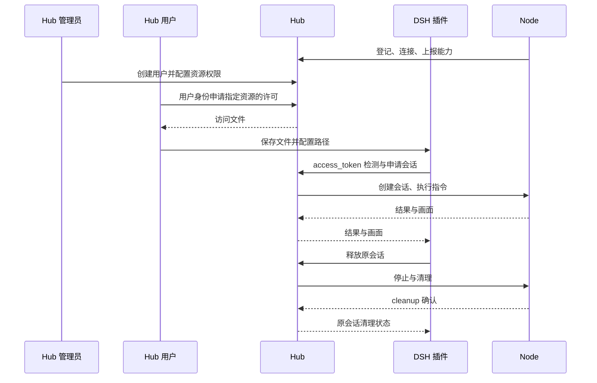

# Hub 统一授权与用户访问许可改造方案

> 历史初稿，已被[Hub 统一认证与 Node 使用权租约改造方案](Hub统一认证与Node使用权租约改造方案.md)取代。本文的用户、账号和按人分配权限模型不符合本轮最新确认的项目定位，未实施；正文保留供追溯，不作为当前改造依据。

日期：2026-10-23（Asia/Shanghai）。状态：**历史初稿，已被替代，未实施**。

本方案以 Hub 0.8.1、Node 0.7.0，以及 DSH-Test-Plugin 当前访问文件和会话实现为依据。核对时插件工作区已包含 0.14.1 的 YAML 支持，发布验收记录仍标记为进行中，不据此宣称该版本已完成分发。

本次只梳理设计、影响和迁移步骤，不修改 Hub、Node 或插件代码，不调整数据库、凭据和日常运行环境，不执行实现验收。现有[DSH 对接指南](../user-guide/DSH-Test-Plugin对接指南.md)仍描述已实现的 Node 所有者授权方式；本方案批准并实施后再同步替换其中的操作步骤。

## 1. 目标与职责边界

将流程调整为：**Node 向 Hub 注册资源；Hub 管理用户及其可用资源；用户直接向 Hub 申请访问许可，将 Hub 导出的访问文件交给 DSH；Node 只接受 Hub 下发的执行任务。**

| 参与者 | 改造后的职责 | 使用的凭据 |
| --- | --- | --- |
| Hub 管理员 | 创建、停用用户，配置用户可用的节点和资源，撤销许可，处理遗留会话 | 独立的 Hub 管理凭据 |
| Hub 用户／调用方 | 查看自己获准使用的资源，申请及撤销自己的访问许可，下载访问文件 | 独立的用户凭据 |
| DSH-Test-Plugin | 读取访问文件，检测连接，申请会话、执行测试、采集证据和确认清理 | 访问文件中的 `access_token` |
| Node | 登记、身份认证、心跳、能力和状态上报、工具执行及清理确认 | 登记凭据及自己的 `node_token` |

注册资源和允许用户使用资源仍是两件事：Node 注册成功不会自动向所有用户开放。由 Hub 管理员预先分配资源范围，Hub 根据该范围批准用户的许可申请；本期不增加每次申请都需要人工审批的工单流程。

以下能力继续复用：单实例单 Worker、SQLite、执行协议 2、HTTP/MCP 共用执行链、现有工具方法、资源独占、会话租期、请求去重、结果查询、PNG 画面和清理状态。此次不新增调度队列、多租户组织、SSO、OAuth、密码找回或完整角色系统。

## 2. 当前实现与需要改变的部分

| 已核对的事实 | 位置 | 对改造的影响 |
| --- | --- | --- |
| 创建许可使用 `node_token` 验证节点所有者 | [api.py](../../src/runbridge_hub/api.py)、[service.py](../../src/runbridge_hub/service.py) 的 `create_grant()` | 将管理权限改为 Hub 用户身份及资源权限，不能只把 CLI 命令换个名字 |
| 许可撤销也要求 Node 身份 | [sessions.py](../../src/runbridge_hub/sessions.py) 的 `revoke()` | 拆开“谁有权撤销”和“执行撤销后的清理” |
| `authorize_owner()` 同时用于控制连接、执行 WS 和画面上传 | [gateway.py](../../src/runbridge_hub/gateway.py)、[sessions.py](../../src/runbridge_hub/sessions.py)、[visual.py](../../src/runbridge_hub/visual.py) | 保留这些设备认证，不能因取消 Node 授权管理而一并删除 |
| grants 没有用户归属，SQLite 当前 schema 为 4 | [store.py](../../src/runbridge_hub/store.py) | 新增用户、权限和审计数据；旧许可不能自动推断属于哪个用户 |
| 会话、启动请求及动作记录以原 `grant_id` 隔离 | [sessions.py](../../src/runbridge_hub/sessions.py)、[browser.py](../../src/runbridge_hub/browser.py)、[commands.py](../../src/runbridge_hub/commands.py) | 增加用户归属时仍保留许可隔离，不允许同一用户用新许可接管旧会话 |
| `/dashboard` 使用独立口令，只读查看全部节点 | [节点总览](../user-guide/节点总览.md) | 不把已有总览口令升级成管理或执行凭据 |
| Node CLI 的 `grant/revoke` 使用本地 `node.json` | Node 项目的 `src/runbridge_node/cli.py`、`client.py` | 从新版 Node 移除许可管理入口，用户操作转到 Hub |
| 插件只读取四项必需字段，并核对会话的 node/grant/resource | 插件的 `src/runbridge.ts`、`src/runbridge-settings.ts` | 保留文件合同及 MCP 返回字段，可以将插件执行链改动控制在很小范围 |

当前许可实际已经由 Hub 生成并保存；主要改造点是**由谁申请、Hub 如何判断申请者权限、许可归属于谁，以及用户在哪里取得文件**。

## 3. 用户身份与资源权限

### 3.1 首期推荐：独立用户身份和随机用户凭据

建议先采用“Hub 管理员创建用户，系统生成该用户专属 `user_token`”的方式。用户使用它访问 Hub 自助许可入口，不使用 Node 凭据。继续复用现有高熵随机令牌及哈希校验方式，避免为本次授权改造同时引入密码体系。

`user_token` 的权限仅包括查看自己的可用资源、申请及管理自己的许可；它**不能直接作为 MCP/执行访问令牌**。DSH 继续使用范围更小、期限明确的 `access_token`。管理员凭据同样不能直接当作执行许可。

管理员初次交付用户凭据后，日常申请和下载访问文件均由用户在 Hub 完成。若组织已要求统一账号登录，可把“密码或现有身份系统接入”改为首期前提；这是待评审取舍，不在本方案中默认为已确定需求。

| 选择 | 优点 | 代价与建议 |
| --- | --- | --- |
| 独立用户令牌 | 复用现有认证方式，Web 与 API 均可使用，改动较小 | 需要妥善保存用户凭据；**首期推荐** |
| 用户名与密码登录 | 符合常见网站登录习惯 | 需要密码存储、会话、退出与重置流程，增加此次范围 |
| 对接现有身份系统 | 可复用已有账号及组织管理 | 目前没有确认具体系统；接口和部署前提待定，暂不纳入 |

### 3.2 权限粒度

- Hub 管理员为用户配置明确的 `(node_id, resource_id)` 列表；没有配置的资源默认不可用。
- 新许可继续只对应一个 Node，可以包含该 Node 内一个或多个已授权资源。DSH 设置仍明确选择其中一个资源 ID。
- 新申请必须包含非空的 `resource_ids`，不使用 `null=该节点所有资源` 的隐含范围，不自动包含 Node 以后新增的资源。
- 管理员增加用户权限不会自动扩大已签发许可；用户需要申请新许可。
- 用户停用、资源权限删除或许可撤销后，受影响的访问许可失效，并进入已有会话关闭与清理流程。
- 首期沿用现有许可期限合同：`expires_in_seconds` 大于 0、最多 31536000 秒，未指定时允许无期限。用户页面默认选择 3600 秒，需要无期限时明确选择，不因授权入口迁移强制缩短旧业务可用的期限。会话自身仍保持当前 1～3600 秒限制。

授权范围与资源当时是否空闲分开判断：已登记且管理员明确授权的资源，即使 Node 暂时离线也可申请许可；Hub 展示离线或历史能力状态，真正启动会话时再检查 ONLINE、能力新鲜度及 READY/FREE。不存在或无法确认的资源不能仅凭用户输入就获准使用。

### 3.3 凭据边界

| 凭据 | 可用于 | 不可用于 |
| --- | --- | --- |
| `enrollment.token` | Node 首次登记 | 用户管理、许可申请、MCP 执行 |
| `node_token` | 本节点控制连接、执行连接、状态及画面上传 | 创建、查询或撤销调用方许可 |
| Hub `admin_token` | 用户与权限管理、许可元数据查询、撤销和运维清理 | 直接冒充一个执行许可 |
| Hub `user_token` | 当前用户的资源目录、许可申请与管理 | 管理其他用户、直接执行浏览器工具 |
| `access_token` | 原许可范围内的 HTTP/MCP、会话及画面访问 | 创建新许可、扩大权限、操作其他许可的会话 |
| 现有 `web.token` | 现有节点总览只读访问 | 新授权页面的用户认证、管理及执行 |

所有访问身份都由 Hub 从凭据确定，不信任调用方提交的 `user_id`、`issued_by` 或权限范围作为授权依据。

## 4. Hub 上的实际操作流程

### 4.1 管理员准备

1. 在 Hub 部署目录生成独立管理凭据，保存在私有文件中，通过 `hub.yaml` 指定路径。复用现有 `generate-token` 工具，不复用登记令牌或只读口令。
2. Node 按原方式登记上线，Hub 能看到已登记节点及上报的资源。
3. 管理员通过 Hub 管理 CLI 创建用户，明确授予节点／资源范围，并交付用户凭据。管理 CLI 调用 Hub 管理 API，不在服务运行时直接改 SQLite。

首期管理员操作以 CLI/API 提供，不同时建设完整后台管理系统；用户侧需要下节所述的可用领取入口。

### 4.2 用户申请与下载

建议在 Hub 同端口增加独立的 **`/access` 用户许可页面**，与原 `/dashboard` 的只读口令和全部节点视图分开：

1. 用户打开 Hub 提供的页面，输入自己的用户凭据。
2. 页面只列出该用户获准使用的节点、资源与当前可用状态。
3. 用户选择 Node、资源和许可期限，提交申请。
4. Hub 校验用户状态、资源权限及期限，在事务中创建许可并记录用户归属。
5. 页面显示本次节点、资源、期限，提供 **YAML 和 JSON 访问文件下载**。YAML 为默认，供旧插件使用的 JSON 同时保留。
6. 用户把文件放到 DSH 宿主，在插件中读取、检测、保存并执行。

创建许可只改变授权记录，不启动浏览器、不预留资源；节点当时空闲也不保证稍后的测试一定能立即开始。YAML／JSON 两个下载入口序列化同一份创建响应，不各自签发一份许可。访问令牌只在创建响应中交付一次，后续列表不回显原文；未保存、刷新页面或丢失文件时，可先从自己的许可列表确认并撤销未保存的许可，再申请新许可，不能从哈希恢复。

用户凭据仅保存在该页面当前内存中，不写入 URL、日志、浏览器存储或导出的 DSH 文件。用户自助 API 提供相同能力，供没有 Web 的部署或脚本使用；不要求 DSH 机器安装 Node 项目，也不要求用户登录 Node 设备。

首期若仅提供 API/CLI，也能实现职责迁移，但仍要求用户额外操作命令或脚本。考虑此次对接指南面向普通插件使用者，**推荐把最小自助页面纳入首期**；不在本方案阶段进行页面视觉设计或实现。

### 4.3 执行、停用和清理



Node 无需接触用户凭据或用户的访问文件，只确认 Hub 控制的本次会话和执行消息。

## 5. API、数据和模块调整

以下路径和字段为**拟定合同，当前不可直接调用**。实施时先冻结接口及错误语义，再同步调用示例。

### 5.1 管理与用户接口

| 接口族 | 认证身份 | 拟定操作 |
| --- | --- | --- |
| `/v1/admin/users` | Hub 管理员 | 创建、查询用户；创建时一次性交付用户凭据 |
| `/v1/admin/users/{user_id}` | Hub 管理员 | 修改名称、停用或启用用户；启用不恢复已撤销许可 |
| `/v1/admin/users/{user_id}/credential` | Hub 管理员 | 重置用户凭据，旧用户凭据立即失效 |
| `/v1/admin/users/{user_id}/permissions` | Hub 管理员 | 查询、替换明确的节点／资源权限 |
| `/v1/admin/grants`、`/v1/admin/grants/{grant_id}` | Hub 管理员 | 查询许可元数据、撤销许可及查看相关清理状态 |
| `/v1/admin/sessions`、`/v1/admin/sessions/{session_id}` | Hub 管理员 | 查询指定许可的会话身份／清理状态，幂等关闭原会话；不提供浏览器业务操作或跨许可接管 |
| `/v1/admin/session-requests` | Hub 管理员 | 按原 grant/node/request ID 查询启动记录，核对未知启动是否实际分配；无记录仍不能当作未执行 |
| `/v1/access/me`、`/v1/access/nodes` | 当前用户 | 查询自己的身份、权限及资源状态，不泄露其他用户和未授权资源 |
| `/v1/access/grants` | 当前用户 | 创建自己的许可、查询自己的许可元数据 |
| `/v1/access/grants/{grant_id}` | 当前用户 | 查询或撤销自己的许可；不允许操作别人的许可 |

拟定创建输入为 `node_id`、非空 `resource_ids` 和可选的 `expires_in_seconds`，不接受指定归属用户。创建响应包含许可元数据与一次性交付的 `access` 对象；后者严格使用第 6 节的五字段合同，页面据此下载文件。

旧 `/v1/nodes/{node_id}/grants` 创建、列表、撤销入口退役，返回明确的 `410` 和迁移指引，不继续接受 `node_token` 管理许可，也不保留绕过用户权限的兼容开关。

原 `/v1/nodes/{node_id}/capabilities`、`/v2` 会话／指令和 `/mcp` 保持执行凭据合同；它们仍使用 `access_token`，不能因为新增用户入口就接受 `user_token` 或管理凭据。

### 5.2 持久数据

| 数据 | 最小调整 |
| --- | --- |
| `users` | 新增 `user_id`、名称、启停状态、`user_token_hash`、创建／更新时间；首期每用户一个有效身份凭据，不增加多密钥管理 |
| `user_resource_permissions` | 新增明确的 `user_id/node_id/resource_id` 关联，唯一约束防止重复；资源删除后不因名称相近自动迁移权限 |
| `grants` | 新许可关联 `user_id`，保留原 grant ID、令牌哈希、Node、资源范围和期限；旧记录允许用户字段为空，仅供历史查询／迁移处置 |
| `authorization_events` | 最小记录用户创建／停用、凭据重置、权限变更、许可签发／撤销的操作者、对象、时间与范围；不记录原始秘密 |
| 会话、启动请求、指令元数据 | 保留原 `grant_id` 隔离及去重键，通过 grant 关联用户，不改为按用户共享会话 |

数据库升级使用下一可用 schema 版本；当前为 4，具体编号在实施前核对其他工作后确定，不覆盖已有迁移。保留旧记录，不伪造旧许可的用户归属。高熵管理、用户、节点及执行凭据分别验证，原文不进入数据库。

### 5.3 模块职责与配置

- 新增独立的用户／权限服务及相应路由，负责管理身份、资源权限、许可申请和审计；不把整套用户管理继续塞入 `NodeService`。
- `NodeService` 保留登记、设备身份、连接与能力查询；当前 `authorize_owner()` 的设备认证用途可以明确为 `authenticate_node()`，所有原有控制、执行、上传调用点逐一保留。
- 会话、指令和画面服务复用统一访问许可解析；MCP 仍逐请求验证，不新增另一套 OAuth 或客户端身份模型。
- 把现有“核验 Node 所有者并撤销”的方法拆开：入口先验证用户归属／管理员权限，内部复用同一份许可撤销与会话关闭逻辑。HTTP、管理 CLI、用户页面不得各自复制清理实现。
- 管理员可通过受限运维接口查询原许可和请求的元数据、关闭原会话，以处理执行令牌已经失效或丢失的情况；不能将管理员身份传入普通浏览器工具冒充访问许可。重试关闭仍返回真实状态，历史 UNKNOWN 不因管理操作自动变为 COMPLETE。
- 管理和用户 API 必须先于根路径的 MCP 挂载注册；关闭 Web 时明确处理 `/access` 前缀，避免落入 MCP 后变成误导的认证错误。

建议只增加与此次管理能力直接相关的配置：

| 拟定配置 | 用途与升级影响 |
| --- | --- |
| `admin_token_file` | 独立 Hub 管理凭据路径，显式配置；缺失／无效时报告配置错误，不回退到登记或总览口令 |
| `public_url` | Hub 导出访问文件使用的实际可达基址，支持代理前缀；不使用监听地址 `0.0.0.0` 或 Node 身份里的回环地址，也不信任任意请求 Host 自动决定导出地址 |

沿用 YAML 相对文件路径解析规则，复用现有许可期限校验，不额外增加上限配置。新增管理／用户秘密不采用现有总览的启动日志输出或带令牌 URL 自动登录方式。现有 `web_enabled` 继续控制内置网页，扩展到新 `/access` 页面；关闭网页不关闭用户／管理 API。`mcp_allowed_hosts/origins` 等现有 MCP 参数按原用途保留，不能把 MCP Host 列表当作新管理 API 的鉴权机制。

## 6. 对访问文件的影响

**推荐保留现有文件格式，改变文件的签发入口与许可的服务器端归属。**

```yaml
# 由 Hub 用户许可入口生成；文件不包含用户管理凭据。
hub_url: "https://hub.example/runbridge"
node_id: "node_example"
grant_id: "grant_example"
access_token: "<Hub本次签发的访问令牌>"
expires_at: "2030-01-01T01:00:00Z"
```

| 字段 | 改造后的来源 | 兼容影响 |
| --- | --- | --- |
| `hub_url` | Hub 部署配置的 `public_url` | 仍为基址，不带末尾 `/mcp`；值必须从 DSH 宿主可达 |
| `node_id` | 用户在获准节点目录中选择 | 类型及意义不变，原 Node 身份无需重建 |
| `grant_id` | Hub 为当前用户本次申请生成 | 类型及会话绑定方式不变；重新签发会产生新值 |
| `access_token` | Hub 创建该许可时生成 | 仍使用 Bearer；不能把用户凭据直接填入此字段 |
| `expires_at` | Hub 根据申请期限计算 | 仍为带时区字符串或 `null`；是否有效以 Hub 中的许可状态为准，不能仅看此字段 |

不向执行访问文件增加 `user_id`、`user_token`、`admin_token` 或 `resource_ids`。用户身份和范围由 Hub 记录与校验；现有 Node `AccessConfig` 拒绝额外字段，贸然加字段会破坏现有调用程序。资源选择继续在 Hub 下载摘要和 DSH `resourceId` 中说明，YAML 可用注释辅助标明。

Hub 默认直接导出带注释 YAML，并保留 JSON 下载，用户不再需要在 Node 机器上转换文件。权限、UTF-8、32 KiB 限制和保存到 DSH 宿主的要求继续适用。

文件**格式兼容**不等于旧许可**继续有效**。存量文件是否要替换取决于第 9 节的迁移选择，不能只改文件注释或手工改 `grant_id`、到期时间完成迁移。

## 7. 对 DSH-Test-Plugin 的影响

### 7.1 保留执行与恢复合同

`readRunBridgeAccess()`、`<hub_url>/mcp`、Bearer 请求头、资源 ID、租期、PNG 预览及会话响应字段均可复用。保留 `node_id/grant_id/resource_id/session_id/page_id` 核对；用户归属不会让不同 grant 的会话变得可互换。

因此首期不要求在插件内增加 Hub 用户登录、保存 `user_token`、申请许可或自动续期。用户在 Hub 下载文件后，仍执行“读取配置 → 检测连接 → 保存”。只使用原 JSON 的 0.14.0 插件也有保留兼容的基础；YAML 使用包含该能力的版本。**能否兼容必须由新 Hub 与实际插件发行包联调确认，不能以字段相同代替验收。**

插件既有只读检测继续使用 `node_inspect`；它验证执行访问许可及节点状态，不验证用户管理凭据，不分配浏览器。

### 7.2 必要的插件调整

| 位置 | 需要调整 |
| --- | --- |
| `src/browser-preferences.ts` | 模板与注释从“Node 所有者签发”改成“从 Hub 用户许可入口下载” |
| `src/client/runbridge-connection.tsx` | 准备说明、字段来源和“如何获取访问文件”的目标说明改为 Hub；继续只填写访问文件路径 |
| `src/runbridge-settings.ts` | 区分认证／权限问题与节点运维问题；许可失效提示联系 Hub 管理员或到 Hub 重新申请，节点离线仍联系设备维护者 |
| `src/runbridge.ts` 及测试环境处置说明 | 将授权／旧会话管理员处置角色改为 Hub 管理员；保留原许可恢复和隔离约束，不降低身份校验 |
| 插件中英文文档、README 相关入口和包内构建产物 | 同步角色、文件来源、兼容版本与迁移步骤；按插件发行规范更新，不仅修改源码文案而遗留旧 `dist` |

新许可不能恢复旧许可的会话。若插件已有遗留隔离，必须先用原许可确认清理，或者由 Hub 管理员清理原会话并提供可核对的处置证据，再按现有插件处置流程处理；不能替换文件后自动解除隔离。

自动从 DSH 内申请许可、刷新令牌、共享同一用户的历史会话、自动解除隔离均不纳入首期。

## 8. 对 Node 的影响

- 保留 `node.json`、`node_token`、登记和统一启动 YAML，Node 重连和执行消息不增加用户凭据；不因为授权迁移而重新生成 Node 身份。
- 新版 Node 移除 `grant/revoke` 的 CLI 与客户端许可管理方法；旧 Node 调用旧 Hub 许可端点时，新 Hub 返回退役指引。
- `inspect` 本身只是调用 Hub 的查询工具，不是节点执行职责，也不是申请许可的前置条件。新用户流程改为 Hub 页面／API 查询，Node 文档不再要求调用方执行 `inspect`；不借此重构其余仍有用的诊断代码。
- Node 0.7.0 的运行进程预计可继续接入新 Hub，因为控制与执行协议不变；需要实际兼容验证，旧 CLI 的许可管理能力不在兼容范围内。
- 本机浏览器路径、启动参数、borrowed 实例的本机允许范围仍由设备配置控制。Hub 用户权限不能据此扩大本机执行能力；本期也不把 borrowed 浏览器新增到 MCP 支持范围。

## 9. 旧许可迁移与发布切换

### 9.1 推荐：维护窗口内收尾，旧许可撤销，用户重新申请

现有 grants 没有用户归属，也可能被多人共用。建议首期不建设自动归属推断或许可认领系统，以免为了兼容旧签发入口再保留一条授权旁路。

1. **盘点**：Hub 管理员导出节点、资源、有效许可及相关会话的无秘密元数据，确认受影响调用方。旧 `resource_ids=null` 不自动转为新用户的全部资源权限。
2. **通知与准备**：预先准备独立管理凭据、对外基址、用户及明确资源范围的配置清单，安排调用方停止发起新任务。
3. **收尾**：逐一释放已分配会话并确认 `cleanup=COMPLETE`；核对启动请求及在途动作没有未决结果。存在 PENDING、UNKNOWN 或无法确认的清理时停止切换，先处理，不能靠升级抹掉记录。
4. **备份**：正常停止 Hub 后备份一致的数据库、启动配置、版本和相关私有文件；不复制正在写入的 SQLite 代替一致性备份。
5. **升级及数据迁移**：保留节点身份及历史记录，升级 schema；将旧来源许可标记为不可执行并明确撤销，保留原 ID、元数据和历史来源。旧记录无用户归属时不予放行。
6. **建立用户权限**：部署新 Hub，在维护访问范围内通过管理入口建立用户与 ACL。Node 按原身份重新连接并上报能力；不执行 Node `grant`。
7. **重新申请**：用户直接在 Hub 申请新许可、下载新文件，在 DSH 中更换路径、读取、检测、保存。新文件的 grant/token 均变化，不能拿新许可继续旧运行。
8. **验收并开放**：确认实际 DSH 浏览器测试、业务断言、画面及清理通过，再恢复日常任务；记录旧许可失效与新文件交付范围。

该方案保留文件格式，但**所有旧 Node 所有者签发的访问文件在切换后失效**。仅升级 Hub、继续使用旧文件不是本方案推荐的兼容行为。仍在用旧文件的客户端应得到清晰的拒绝和换取指引，不悄悄兼容无用户归属的许可。

### 9.2 可选：显式绑定存量许可

若现网接入多、统一更换成本较高，可另行选择管理员为旧许可显式指定用户，校验其原范围在新用户权限内，保留原 grant ID 和令牌哈希。这样可不更换对应访问文件，原始令牌也无需取回。

代价是需要增加绑定工具、审计和迁移校验；多人共用许可无法据此区分个人身份，`null` 全资源范围还需明确冻结成资源列表。绑定方案不能自动猜用户，也不能把所有旧许可归给管理员。**它是替代迁移选择，首期默认不同时实现两套方案。**

### 9.3 回退边界

新 schema 不交给旧版本程序直接写入。回退需要再次停止任务、清理资源并保存新版本运行资料后，恢复完整的旧版本数据库和配置备份；单独降级 wheel 不足以回退。

恢复旧备份也会恢复旧权限模型及当时的令牌状态，可能重新启用切换后已经撤销的许可。回退前必须明确影响并限制入口，不能作为对用户透明的切换；可修复时优先修复新版本再继续运行。

## 10. 权限变更和在途操作的处理

| 事件 | 推荐语义 |
| --- | --- |
| 用户主动撤销自己的许可 | Hub 先持久标记失效，再复用关闭、画面断开、队列停止及清理确认；不等待 Node 所有者批准 |
| 管理员撤销许可 | 相同清理链，记录管理员身份；不能复用该管理凭据操作浏览器业务 |
| 用户停用 | 撤销该用户所有有效许可，阻止新申请与新动作；重启后仍然失效 |
| 删除用户的某个资源权限 | 撤销包含该资源的整份许可，复用现有按 grant 关闭逻辑；即使许可还包含其他资源也先整体失效，用户可重新申请剩余范围 |
| 增加用户资源权限或重新启用用户 | 不自动扩大／复活旧许可，需要新的申请 |
| 重置 `user_token` | 旧用户凭据不能继续申请或管理许可；已签发执行许可默认不自动撤销，用户可用新身份凭据管理它们。需要停止全部执行时使用“停用用户／撤销许可”，界面必须说明区别 |
| 更换 DSH 访问文件 | 下一次测试使用新许可；运行中连接保持原身份，新许可不接管旧会话 |

权限与失效状态须在同一受控事务／锁边界中更新，防止申请或派发动作越过变更。提交和下发指令前都复核有效身份、用户状态、许可、资源范围及租期；等待 Node 清理时不长期占用全局权限锁。

对已发送给 Node 的写操作，撤销不能承诺撤回已经发生的业务修改。保留实际结果、`OUTCOME_UNKNOWN` 和原请求查询语义，不自动重放。离线、清理超时或结果不确定时，仍以 UNKNOWN/PENDING 表达，不能因为管理员点击成功就写成清理 COMPLETE。

## 11. 文档更新清单

这些是**实施阶段应修改的当前文档**，本次方案阶段不提前改成尚未实现的新流程。

| 项目 | 文档／入口 | 修改内容 |
| --- | --- | --- |
| Hub | `README.md`、`doc/README.md`、`doc/user-guide/快速开始.md` | 增加管理员初始化、用户入口及阅读路线，区分 Node 登记与用户授权 |
| Hub | `doc/user-guide/DSH-Test-Plugin对接指南.md` | 核心流程改为管理员分配范围、用户在 Hub 下载文件、插件配置；移除 Node `grant` 和强制 CLI 检查说明，默认不再要求 JSON→YAML 转换 |
| Hub | `doc/user-guide/调用方对接与使用.md`、`MCP浏览器接入.md` | 文件来源改为 Hub；保持执行字段、MCP 调用和清理合同 |
| Hub | `doc/reference/部署配置与凭据.md`、`参数详解.md`、启动 YAML 样例 | 新凭据的生成者、持有人、用途、权限、路径和配置优先级；新增管理配置和下载基址 |
| Hub | API 参考、架构和运行排障 | 新管理／用户 API、用户与许可归属、旧端点退役、权限变更与清理、切换和回退 |
| Hub | `doc/user-guide/节点总览.md` | 保留现有页面只读合同，说明它与新用户入口不同，不把只读链接当成领取许可入口 |
| Node | README、快速开始、部署、CLI 参数及文件说明 | 删除 Node 所有者签发／交付访问许可的主流程；只交付登记、运行和资源信息，授权入口指向 Hub |
| DSH 插件 | 中英文 README、安装／使用／远程浏览器／环境处置文档 | 获取文件改为 Hub，自助申请、下载格式和旧许可更换说明；分别指明授权问题找 Hub 管理员、设备问题找 Node 维护者 |

历史方案、旧验收和发布记录保留原日期与当时合同，只标注历史边界，不批量替换历史“所有者签发”证据。对外示例和下载模板同步更新，避免 UI 与文档各给一套来源。

## 12. 实施顺序与验收标准

### 12.1 分阶段实施

| 阶段 | 工作 | 完成条件 |
| --- | --- | --- |
| A：冻结方案 | 确认用户身份方式、自助入口、期限策略和旧许可迁移方式，冻结 API／文件合同 | 关键取舍确认后才开始代码修改 |
| B：Hub 授权基础 | 管理凭据、用户、明确资源权限、schema、统一鉴权、签发／撤销及审计；关闭旧 Node 管理许可入口 | 用户可直接获取许可，凭据边界和撤销链通过离线及接口验证 |
| C：用户领取入口 | 最小 `/access` 页面、限定目录、期限输入、YAML／JSON 下载及 API 示例 | 用户不接触 Node 即可完成领取；申请不分配浏览器，秘密不进入 URL 或日志 |
| D：跨仓库衔接 | Node 移除许可管理；插件必要文案与错误引导调整；同步各项目当前文档 | 文件、MCP 和会话合同保持一致；新用户流程没有 Node `grant` 依赖 |
| E：迁移与发行 | 在独立环境演练切换、旧文件失效、实际插件测试与恢复；完成打包及发布记录 | 按既定迁移方案验证数据、权限、业务结果与真实清理，才安排日常环境切换 |

B、C 阶段不能仅完成 CLI 改名或文件下载；必须已有可执行的用户资源权限判断。D 阶段不改测试计划、断言或浏览器执行能力来迁就新授权方式。

### 12.2 实施后的验收用例（本次均未执行）

| 编号 | 验收内容 | 成功标准 |
| --- | --- | --- |
| V01 | Node 登记与重连 | 原身份及执行协议可用，能力上报不包含用户凭据；Node 无需申请执行访问许可 |
| V02 | 用户直接申请 | 管理员配置权限后，用户仅访问 Hub 即可下载可用文件，全链不调用 Node `grant`，不启动浏览器 |
| V03 | 无权限与越权 | 无资源权限目录为空；申请未授权资源、伪造 `user_id`、管理其他用户许可均拒绝 |
| V04 | 凭据互换 | 登记、Node、总览、管理、用户和执行凭据严格区分；执行令牌不能派生新许可 |
| V05 | 固定资源范围 | 新增 Node 资源或增加用户权限不会扩大旧 grant；空列表／隐含全资源不被接受 |
| V06 | 期限和状态 | 默认值、现有一年上限、显式无期限及到期行为正确；离线资源授权和在线执行检查分开，不用 health 或许可签发成功证明浏览器可用 |
| V07 | 撤销与用户停用 | 普通 HTTP、已建立的 MCP、排队动作和已订阅画面都受影响；Node 清理状态真实可查，失败不冒充 COMPLETE |
| V08 | 权限删除与竞争 | 权限变更与并发申请／提交正确串行；受影响整份 grant 失效，其他用户权限不变 |
| V09 | 用户凭据重置 | 旧用户凭据失效，新凭据能管理原用户许可；已签发许可是否保留符合第 10 节语义 |
| V10 | 会话隔离与未知结果 | 同用户新 grant 无法接管旧会话；管理员在访问令牌失效时可查原启动记录及请求关闭；业务未知结果不重放，隔离不自动解除 |
| V11 | 文件与旧客户端 | 导出只有原五字段、无管理秘密；JSON 可供原客户端读取，YAML 被支持版本解析；代理前缀和 DSH 宿主路径正确 |
| V12 | DSH 实际闭环 | 使用真实发行包完成读取、只读检测、浏览器业务、必要断言、PNG 画面和 cleanup 确认；保留受支持 DSH 宿主基线 |
| V13 | 旧端点与旧许可 | Node 凭据无法再签发／撤销许可；推荐重签方案下旧文件失效、历史可查、新文件可用，无兼容后门 |
| V14 | 数据迁移与回退演练 | 先核对 schema，预检可重复且不改数据；不覆盖迁移或丢历史；旧程序不会写新库，回退权限影响有记录 |
| V15 | 自助页面与秘密 | 用户只看自己的目录及许可；两种下载格式字段一致，令牌不写 URL／日志／持久浏览器存储，下载失败有重新申请指引 |
| V16 | 文档与发行 | 当前中英文文档、帮助、模板和实际流程一致；版本同步、Hub/Node 各自本地 wheel/sdist、全新安装检查和插件发行包检查完成 |

实现阶段的 Python 检查使用各仓库根目录 `.venv` 和 pytest；服务联调、浏览器和真实 DSH 验收使用独立环境及受控数据。静态文档检查、包安装检查、接口验证与实际运行验收分别记录，不能相互替代。

## 13. 主要风险与待确认事项

| 事项 | 推荐方案／风险边界 | 评审需要确认的选择 |
| --- | --- | --- |
| 用户如何认证 | 先采用 Hub 管理的独立用户令牌，避免引入完整密码体系 | 是否首期必须使用用户名密码或已有身份系统 |
| 用户在哪里领取 | Hub 最小自助网页＋同等 API；管理员先用 CLI/API | 是否接受自助页面纳入首期，还是仅做命令行／API |
| 旧访问文件 | 推荐维护窗口收尾后统一撤销重签，格式保持不变 | 是否存在不能换文件的调用方，因而必须选择显式绑定迁移 |
| 许可期限 | 首期复用现有期限、无期限和撤销规则，页面默认一小时 | 若业务另需收紧期限再单独确定，不默认增加新限制或自动续期 |
| 权限收回粒度 | 删除某资源权限时整份相关 grant 失效，复用现有清理链 | 是否接受其他仍获准资源也需重新申请，避免首期增加部分撤销状态机 |

已明确的目标是授权管理归 Hub、用户直接向 Hub 取得许可、Node 退出许可管理。上表其余内容是本方案建议，不冒充已确认决定。方案通过后按阶段实施；当前代码、数据和运行行为仍以原实现为准。
