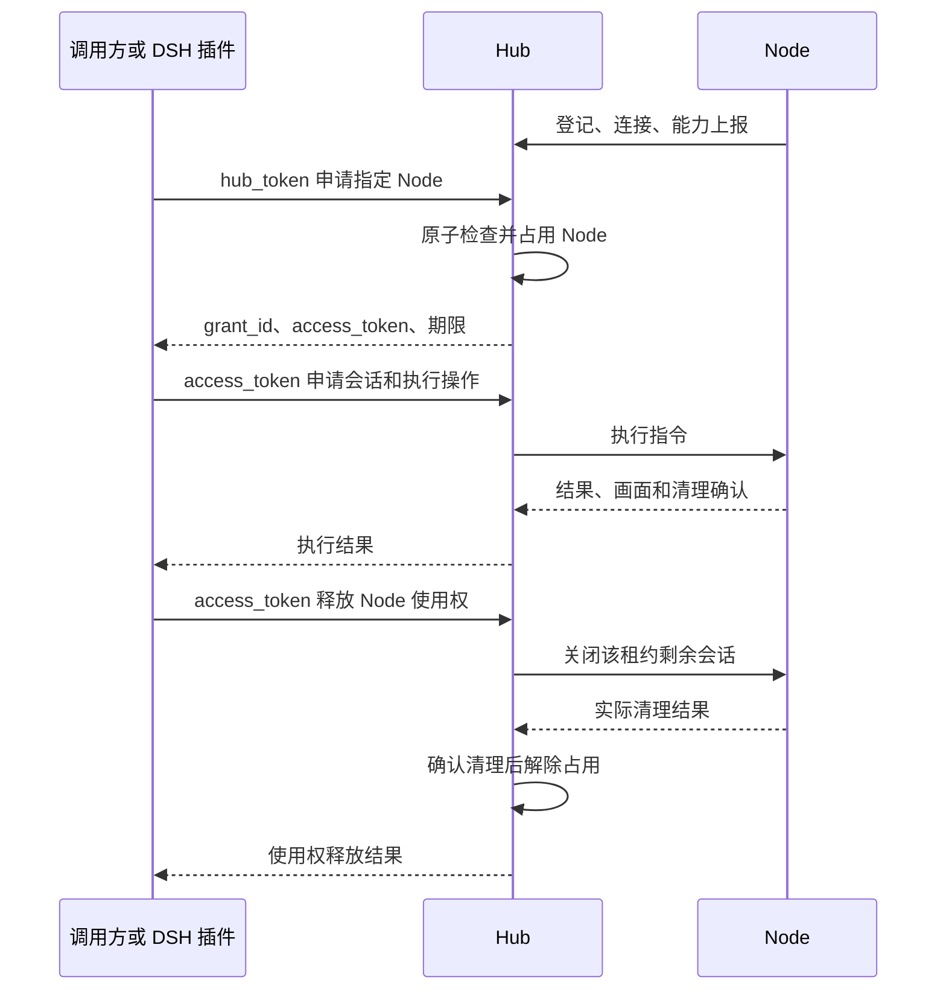
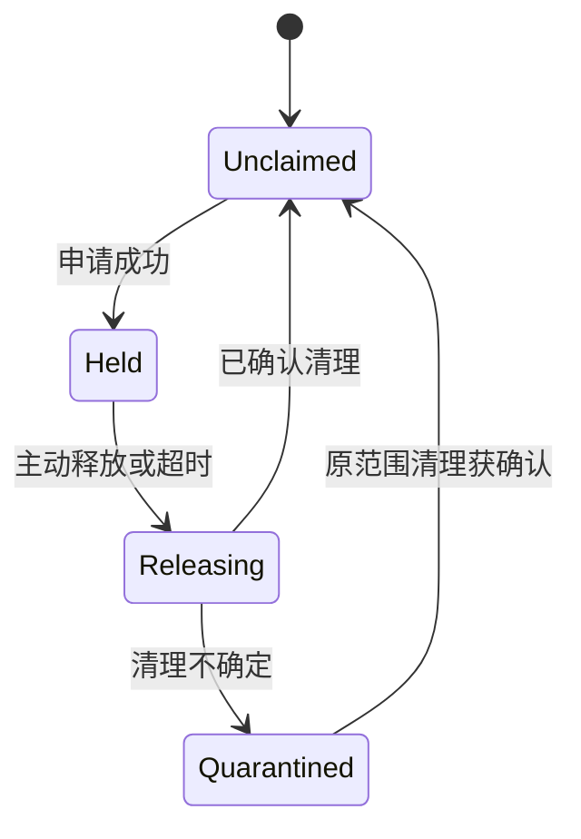

# Hub 统一认证与 Node 使用权租约改造方案

日期：2026-10-23（Asia/Shanghai）。状态：**已按用户确认实施，本文保留设计时的拟定措辞**。

当前实现以[租约接口](../reference/Node使用权租约接口.md)、[运行与排障](../deployment/运行与排障.md)和[验收记录](../project/Node使用权租约改造验收.md)为准；下文“尚未实施”等描述属于方案制定时的历史状态。

本方案按最新确认的项目定位重写：Hub 是 Node 使用权的交接集散地，不维护用户身份、账号、角色或按人配置的资源权限。持有 Hub 申请凭据的调用方可以申请指定 Node；申请成功后，只有持有本次节点令牌的请求可以经 Hub 操作该 Node。

[前稿](Hub统一授权与用户访问许可改造方案.md)中的用户和权限分配模型不再适用，保留原文供追溯。本次仅修订方案及导航，不修改 Hub、Node 或 DSH 插件代码，不调整数据和运行环境，不执行实现验收。现有操作指南在改造实际落地后再同步更新。

## 1. 核心模型：申请凭据与节点租约

只保留两层调用方凭据：

| 凭据 | 谁持有 | 能做什么 |
| --- | --- | --- |
| Hub 申请凭据 `hub_token` | 获准使用该 Hub 资源池的调用方，可以由多人共享 | 查询可申请的 Node 和能力，申请一个未被占用的 Node |
| 节点租约令牌 `access_token` | 某次申请成功后取得令牌的持有者 | 操作本次租约对应的 Node，查询、续租和释放本次使用权 |

Hub 不记录“谁申请”，只记录“哪个 Node 被哪份租约占用、何时到期、何时有执行活动、如何释放”。保留 `grant_id` 标识这份租约，继续使用原 `access_token` 作为执行凭据，不另外增加一套 lease ID。

`hub_token` 不能直接用于 MCP 执行，也不能取回、续租、释放或接管其他持有者的租约。一个 Node 已被领取时，其他持有 Hub 凭据的请求得到明确的占用结果，不再签发第二份可操作它的令牌。

持有同一节点令牌的多个客户端属于同一份使用权；Hub 无法也不需要区分这些客户端背后的人。需要可靠交接时，先释放旧租约，再申请生成新令牌；复制令牌本身不会让原副本失效。

Node 的登记凭据、设备身份 `node_token` 和现有总览只读口令继续保持各自用途，不与 Hub 申请凭据复用。Node 的登记、能力上报、控制连接、执行及画面上传仍需要设备认证。

## 2. 领取范围与独占规则

首期按 **整个 Node 独占** 设计，而不是仅独占某个浏览器资源：

1. Node 登记到 Hub，即加入该 Hub 管理的设备池，不再由设备所有者逐份签发调用许可。
2. Hub 在事务中检查节点可用状态及租约占用，原子地创建一份租约并占住该 Node。
3. 同一 Node 同时最多存在一份 HELD、RELEASING 或 QUARANTINED 租约。
4. 租约持有者可以按 Node 实际支持的能力使用资源；资源自身的独占、支持范围和本机配置限制继续生效。MCP 当前仍只支持 managed 浏览器。
5. 新持有者只能在旧使用权已结束、相关执行已确认清理后领取，不能仅凭到期时间就覆盖旧占用。

Node 是否在线、执行资源是否空闲、Node 使用权是否被领取是三种不同状态。例如浏览器已经关闭、资源显示 FREE 时，Node 仍可能被原持有者的租约占用。

因此应分开呈现：

- 资源池／总览显示 Node 的“未领取、已领取、回收中、待核查”和在线／离线状态。
- 持有者调用 `node_inspect` 时，资源仍显示真实 READY/FREE 或 BUSY，不能因为 Node 已被自己领取就把所有资源伪装成 BUSY，导致插件无法启动浏览器。
- 新申请除检查租约外，还要检查 Node 在线、能力有效，以及不存在遗留执行或未确认清理。首期冲突直接返回 NODE_LEASE_BUSY，不增加预约、排队或抢占机制。

## 3. 申请、使用与释放流程



申请只占用使用权，不启动浏览器。浏览器会话按实际操作需要创建；一份 Node 租约可以先后承载多条用例和多个会话，但均归属于原 `grant_id`。

**关闭某个浏览器会话不自动交还 Node。** 调用方结束整个任务或一批测试后，单独调用使用权释放接口。这样同一批中的下一条用例可以继续创建浏览器，而不会因上一条用例关闭浏览器就失去设备。

## 4. 长期持有却没有使用：两项超时机制

采用“有限租期＋空闲回收”，不提供永久领取。以下参数已按本轮要求确认，当前仍只记录在方案中，尚未实施：

| 项目 | 已确认规则 | 作用 |
| --- | --- | --- |
| 本次租期 `lease_seconds` | 默认 3600 秒，申请者可填写正整数秒，不能超过 Hub 当前配置的上限 | 给本次令牌设置确定的 `expires_at`，防止失联后无限占用 |
| 租期上限 `grant_max_lease_seconds` | 默认 86400 秒（一天），可通过 Hub 配置文件修改 | 统一限制申请及续租时填写的时长；一天是默认上限，不是不可调整的硬编码值 |
| 空闲回收 `grant_idle_timeout_seconds` | 默认 600 秒（十分钟），可通过 Hub 配置文件修改为正整数秒 | 领取后未使用，或使用中停止执行活动，达到空闲期限后自动回收 |

未填写 `lease_seconds` 时按 3600 秒申请；若部署者把租期上限配置为小于 3600 秒，则未填写时采用该上限，确保默认申请也不会超限。显式填写超出上限的时长时明确拒绝，不静默截断。续租沿用相同的默认值和上限校验。

租期和空闲策略共同约束使用权：确定租期以 `expires_at` 为界；没有有效在途执行时，空闲以 `idle_deadline_at` 为界。有实际在途执行时按下节暂停空闲倒计时，确定租期继续生效。Hub 以服务器时间判断，定时任务只是执行回收，不是失效判断的唯一位置；即使回收循环尚未运行，已经失效的请求也不能被放行。

### 4.1 初次领取后没有开始使用

申请成功时，空闲计时从领取时间开始。按默认配置，若十分钟内没有实际执行活动，即使令牌原本有一小时期限，也回收该使用权。

示例：10:00 领取，默认租期到 11:00；一直没有使用，则 10:10 开始回收，不等到 11:00。修改空闲配置后，示例中的回收时间按实际配置计算。

### 4.2 使用过程中停了很久

实际会话创建或有效执行活动更新 `last_activity_at`；活动结束后重新计算空闲期限。例如默认空闲期限下，最后一次浏览器动作 10:10 完成，之后没有新执行，10:20 开始回收。

有效且受现有执行超时约束的在途命令，不因为尚未完成就直接按空闲释放；它仍受会话和租约的确定到期时间约束。此时状态接口显示“执行中”，空闲倒计时在执行完成后重新开始，不展示一个已经过期却仍声称有效的空闲截止时间。在途异常进入既有超时／结果未知处理，不能借一个永不结算的请求无限保持有效使用权。

### 4.3 哪些请求算使用

| 活动 | 是否刷新空闲计时 | 原因 |
| --- | --- | --- |
| 实际创建执行会话，受理并派发有效浏览器操作 | 是 | 表示真正开始或继续使用设备 |
| 业务需要的页面读取、DOM／截图采集等执行操作 | 是 | 只读业务操作同样属于使用 |
| 正常关闭会话并收到清理确认 | 是，以完成时间开始空闲期 | 允许同一批任务在用例间短暂停顿 |
| MCP 握手、工具清单、`node_inspect`、`browser_status`、会话／请求状态查询 | 否 | 状态轮询不能一直占住设备 |
| 订阅画面、持续收到 PNG、保持网络连接 | 否 | 一直看旧页面不代表继续执行任务 |
| Node 心跳或能力上报 | 否 | 只说明设备在线，与调用方使用无关 |
| 租约续租或客户端保活 | 否 | 不能靠不断续租绕过空闲回收 |
| 无效、越权、仅命中状态查询的重复请求 | 否 | 不作为新的设备活动 |

仅存在 READY／ACTIVE 会话、一直打开空白浏览器不构成持续在途执行，没有实际操作时仍会空闲回收。对幂等请求的重复响应，不因为重复 HTTP 请求就刷新活动时间；以原操作真实生命周期为准。会话启动失败、清理不确定等状态也不能伪造为成功活动。

### 4.4 正在使用但租期快到了

持有节点令牌的调用方可以续租，Hub 返回新的 `expires_at`。建议以当前时间加申请时长计算，并且不缩短原有效期限；每次续租时长受 Hub 当前 `grant_max_lease_seconds` 配置约束，默认最多 86400 秒。

续租有四个约束：

1. 必须持有该租约的节点令牌，Hub 申请凭据不能代替。
2. 租约必须仍有效、仍占有该 Node，且不处于回收或待核查状态；过期后不能复活。
3. **续租不修改 `last_activity_at` 或空闲期限**，因此“从不使用但一直续租”仍会被回收。
4. 续 Node 使用权不延长已经创建的浏览器会话租期；现有会话 1～3600 秒限制继续生效。

这里不另外设计一套能保住空闲租约的心跳接口。持续有有效执行活动的任务可以续租；是否限制最大连续占用总时长属于另一个公平调度策略，首期不扩展。

## 5. 使用完毕如何主动释放

释放必须是显式、幂等的业务操作，不依赖网页关闭、MCP 断开或客户端析构。

### 5.1 正常路径

1. 停止提交该任务的新业务动作，等待在途操作结算。
2. 正常关闭本批创建的浏览器会话，记录原会话 `cleanup`。
3. 用本次 `access_token` 请求释放原 `grant_id` 的 Node 使用权。
4. Hub 原子地将租约置为 RELEASING，立即拒绝旧令牌的新执行及续租，关闭该租约遗漏的会话、执行连接和画面流。
5. 确认所有相关会话、准备请求和清理已结束后，标记 RELEASED 并解除 Node 占用；之后才允许下一次领取。

如果租约下从未创建会话，也没有未决的准备请求，Hub 可以直接完成释放。若调用方没有提前关闭会话，释放接口也要负责收尾，不能要求调用方严格完成前两步才允许回收。

### 5.2 回收状态



图中 Unclaimed 仅表示没有使用权占用，Node 是否在线、资源是否就绪仍需另外检查。

| 租约状态 | 旧令牌可执行 | 其他申请可领取 |
| --- | --- | --- |
| HELD，且未超时 | 是 | 否 |
| RELEASING | 否 | 否 |
| QUARANTINED | 否 | 否 |
| RELEASED | 否 | 满足节点可用条件时可以 |

主动释放、租期到期、空闲回收都走同一条内部回收流程，分别记录 RELEASED_BY_HOLDER、LEASE_EXPIRED、IDLE_TIMEOUT 等原因。数据库标记失效不等于浏览器已清理；UNKNOWN/PENDING 不能直接变成可领取。

释放接口可先返回 202 和回收中状态，清理已经完成则返回 200。调用方继续用原令牌查询**这份旧租约**的回收结果；即使令牌已不能执行，也必须允许其只读查询自己的终态，重复释放也只返回原状态，不影响后来新租约。

### 5.3 崩溃、离线和重启

- 客户端退出、崩溃或网络断开：不把断线直接等同于正常释放，由空闲／租期机制兜底。
- Node 离线且存在未确认执行：停止旧许可执行并保留占用，进入回收或待核查；不能把 Node 离线当作清理成功。
- Hub 重启：读取持久化的到期和活动时间，不重置时钟、不自动给租约续命；超时租约先进入回收。原会话中断和未知动作保持原语义。
- Hub 新进程没有旧会话对象时：仍根据持久租约及未确认记录阻止交接，不能因为内存列表为空就把 Node 释放。
- 无法取得可信清理结果：由设备维护者核查原任务，Hub 维护者在受控维护流程中记录与原租约相关的处置证据。保留原 UNKNOWN，不伪造 Node 的 COMPLETE；普通共享 Hub 凭据不开放强制清空占用的接口。

## 6. 拟定 API 与认证边界

以下是拟定接口，不是当前可运行合同：

| 接口 | 认证凭据 | 行为 |
| --- | --- | --- |
| `GET /v1/pool/nodes` | Hub 申请凭据 | 节点目录、在线／能力状态、是否已领取，不返回节点令牌 |
| `GET /v1/pool/nodes/{node_id}/tools` | Hub 申请凭据 | 只读工具／方法声明，供执行前准备或计划使用，不占设备 |
| `POST /v1/nodes/{node_id}/grants` | Hub 申请凭据 | 原子申请该 Node，生成有限租约和一次性访问文件 |
| `GET /v1/grants/{grant_id}` | 本租约的节点令牌 | 查询原租约期限、空闲期限、回收及清理状态 |
| `POST /v1/grants/{grant_id}/renew` | 本租约的节点令牌 | 在仍有效时续租，不刷新空闲计时 |
| `DELETE /v1/grants/{grant_id}` | 本租约的节点令牌 | 幂等释放本次 Node 使用权 |
| 现有 `/mcp`、HTTP 会话和执行接口 | 当前有效节点令牌 | 在该 Node 当前租约范围内执行，保留原会话隔离 |

创建输入为唯一 `request_id` 和可选的 `lease_seconds`，Node 由路径确定。`lease_seconds` 由申请者填写，未填写默认 3600 秒，并按第 4 节规则受 Hub 配置上限约束。整 Node 使用权不再要求为每个申请配置资源 ACL；具体执行仍选择 Node 实际支持的 `resource_id`。

现有创建 grant 路径可以复用，但认证改成 Hub 申请凭据，原 Node CLI 携带 `node_token` 调用时必须被拒绝并给出迁移指引。旧 Node 所有者的许可管理入口不保留为旁路。

执行／续租使用“有效租约校验”；原租约状态查询和重复释放使用“持有者凭据匹配校验”。后者可以在租约过期后读取原状态，但不能再执行、新建会话、读新持有者数据或关闭新租约的资源。

### 6.1 申请响应丢失

并发领取和 HTTP 重试必须受数据库唯一约束与 `request_id` 去重控制。同一请求不能产生第二份租约，已结束请求不能被迟到重试重新激活；不同内容复用 ID 明确冲突。

访问令牌仍只在首次创建时交付，数据库只保留哈希。仅持有共享 Hub 凭据及公开请求 ID，不能重下载某个活动租约的原始令牌，否则会绕过独占持有者边界。

若调用方完全丢失首次响应、没有取得节点令牌，重复申请只返回有限的已创建状态和 `token_available=false`，不再次交付秘密；本期不为此引入密钥托管。调用方不得猜 token 或用新请求覆盖占用，可等待该未使用租约按空闲期限回收，再明确发起新申请。该取舍牺牲少量异常情况下的等待时间，换取更小的实现和明确的令牌边界。

### 6.2 Hub 凭据更换

更换 Hub 申请凭据只影响后续申请，已有节点令牌仍按其租期、空闲期限和主动释放机制结束，不要求每次执行再次携带 Hub 凭据。如果部署更换凭据需要重启，重启本身仍按现有执行中断规则处理，不能因此承诺业务无中断。

## 7. 最小数据与模块调整

### 7.1 复用 grants 表

将现有 grant 明确为 Node 使用权租约，建议扩展：

- 保留 `grant_id/node_id/token_hash/created_at/expires_at`，新租约的 `expires_at` 不再允许空值。
- 增加 `state/last_activity_at/idle_timeout_seconds/released_at/close_reason`，保留与原会话／启动请求的关联。
- 增加领取请求 ID 及内容摘要，支持申请去重；不把 Hub 凭据或原始节点令牌写入请求记录。
- 对 HELD、RELEASING、QUARANTINED 状态建立“每个 Node 最多一份”的数据库唯一约束，不能仅靠前端按钮或进程内字典。
- 不增加 users、角色、用户凭据、按人资源权限或许可认领表。必要事件只记录租约、动作、时间与回收原因，不推断申请者身份。

当前 schema 为 4，迁移编号实施前核对再确定。当前多份旧 grant 可能指向同一 Node，必须按迁移步骤先处理，不能直接建立唯一索引并覆盖冲突记录。

### 7.2 服务边界

新增或拆出独立的租约服务，负责领取、续租、活动记录、到期／空闲维护与释放状态。复用现有会话和清理服务，不建设用户管理服务。

关键执行门禁：每次新建会话、接收和真正派发指令、接入画面或返回受保护数据前，都确认原 `grant_id` 仍是该 Node 的有效持有租约。领取、进入回收和解除占用在一致的事务／锁边界完成；等待 Node 清理时不长期持有全局锁。

设备认证与租约认证分开：原 `authorize_owner()` 在控制连接、执行 WS、上传的用途必须保留并明确命名；创建和释放调用方租约不再使用 Node 身份。Node 不需要接收 Hub 申请凭据或节点访问令牌，也不增加用户字段。

资源池目录可以查询占用，普通执行入口不能凭共享 Hub 凭据绕过租约。原会话、启动请求、命令的 grant/session/request 隔离和结果未知语义继续保留。

### 7.3 Hub 配置

| 拟定配置 | 用途 |
| --- | --- |
| `hub_token_file` | 共享的 Hub 申请凭据文件，独立生成；不能复用登记或总览口令 |
| `public_url` | 导出文件中的实际可达 Hub 基址，支持反向代理前缀，不使用监听地址或任意请求 Host |
| `grant_max_lease_seconds` | 申请及续租的租期上限，默认 86400 秒；配置文件可修改，必须为正整数秒 |
| `grant_idle_timeout_seconds` | 新领取租约采用的空闲期限，默认 600 秒；配置文件可修改为正整数秒，保存到租约作为其策略快照 |

拟定的 `hub.yaml` 字段如下，**当前版本尚未实现，不能直接加入现有生产配置**：

```yaml
# 未填写本次租期时默认 3600 秒；申请者也可在申请中填写 lease_seconds。
grant_max_lease_seconds: 86400  # 默认一天；每次申请及续租不得超过此值。
grant_idle_timeout_seconds: 600  # 默认空闲十分钟回收。
```

修改配置后按现有方式正常重启 Hub 生效，不在本次加入配置热更新。新的租期上限用于后续申请与续租，不追溯缩短已经签发的到期时间；新的空闲配置用于新领取租约，存量租约继续使用领取时保存的空闲策略，续租不重置该策略或空闲计时。重启本身仍按既有会话中断规则处理。

节点使用权租期与浏览器会话租期分别校验；此次将节点租约上限改为可配置，并不改变现有浏览器会话 1～3600 秒限制。沿用 YAML 相对路径规则；秘密不输出到启动日志或 URL。

## 8. 对访问文件和 DSH 插件的影响

### 8.1 节点访问文件保持五字段

Hub 领取成功后，仍可以导出原 JSON 或带注释 YAML：

```yaml
# 本文件是一份有限的 Node 使用权，释放或回收后不能继续使用。
hub_url: "https://hub.example/runbridge"
node_id: "node_example"
grant_id: "grant_example"
access_token: "<Hub本次签发的节点令牌>"
expires_at: "2030-01-01T01:00:00Z"
```

这些字段可以继续被现有解析器读取，但**文件格式兼容不等于使用行为完全兼容**：节点使用权现在会因空闲而提前回收，使用后要主动释放，长任务可能需要续租；不能继续把文件当作可长期复用的静态访问授权。

`expires_at` 是导出时的租期，不包含完整的空闲状态，续租后也可能改变。实际状态应向 Hub 查询；改本地时间字段不能续租或恢复已回收使用权。

### 8.2 推荐新增 Hub 自动领取模式

为实现“测试要用时申请、整批结束后释放、下一批再申请”，DSH 插件需要接入租约生命周期，不能只修改文案。

建议保留现有访问文件入口，并新增一个明确区分的来源：

| 模式 | 配置来源 | 行为 |
| --- | --- | --- |
| Hub 自动领取（推荐） | Hub 认证文件路径、目标 `node_id`、现有资源 ID／会话租期等 | 执行阶段开始前领取并建立 MCP；运行中按需续租；整批结束释放；下一批重新领取 |
| 已领取访问文件（兼容） | 现有五字段文件路径 | 使用现成租约，支持查状态、续租和释放；失效后不自动申请，因为没有 Hub 申请凭据 |

Hub 认证文件只放 Hub 基址和共享申请凭据，例如：

```yaml
hub_url: "https://hub.example/runbridge"
hub_token: "<Hub申请凭据>"
```

该文件不是原节点访问文件，应由明确的模式选择和独立解析器读取，不通过“缺少 grant 字段就猜另一种格式”弱化原校验。Hub 凭据只由插件服务端读取，不进入模型上下文、用例、普通设置字段或报告。

### 8.3 规划和审核不占设备

当前插件 `prepareRuntime()` 在计划审核之前建立 RunBridge 连接；新模式不能照搬这一时机提前领取，导致等待审核时占着 Node。

建议先通过 Hub 凭据读取只读能力／工具目录，完成规划和审核；目录从 Hub 同一份工具定义生成，不另外维护一套手写 schema。真正进入执行时再领取租约、建立 MCP，用实际 `tools/list` 复核并安装当前 Agent 的工具投影；定义不符时在执行业务前停止。已有审批和同一 Agent 生命周期保持一致，不另起执行 Agent。纯接口用例不领取 Node。

设置页的 Hub 模式检测只证明申请凭据和目录可达，不能声称“已领取”或“已验证 MCP 执行连接”；现成访问文件模式可以检查对应租约和 MCP，检测本身仍不刷新空闲计时。

手工提前领取后长期等待审核，使用权仍可能被空闲回收。兼容模式需明确提示在执行前领取，或改用自动模式，不能用设置页轮询替持有者保住设备。

### 8.4 按批次释放，而不是逐用例释放

- TXT／Markdown 多用例及 CSV 多实例的一次完整运行共用一份 Node 租约；每条用例继续使用原浏览器初始化／关闭流程。
- 最后一条用例结束，或取消／失败收尾后，等待原会话清理，再释放 Node 使用权。
- 租约续租不刷新空闲时间；长时间只做模型思考或等待人工输入仍可能被回收，界面应提示空闲截止时间和实际状态。
- 客户端崩溃无法执行释放时，由 Hub 超时回收兜底；进程正常退出／插件卸载尽力执行同一收尾链。
- 不能把租约释放放在 `dispose()` 的无等待请求中就宣布完成。现有报告封存路径需等待或明确记录 Node 使用权释放状态，再给出最终清理结论。
- Node 使用权释放未确认时，单独记录相应隔离／未完成状态，保留已有业务断言；不能只看到 `browser_stop.cleanup=COMPLETE` 就宣布整个设备已归还。

若租约在运行中失效，停止旧任务并保留原 grant、session 和请求证据；不能自动领取新租约继续原步骤。下一次新的测试可以重新申请，不能将其冒充旧运行恢复。

## 9. 对 Node 与执行协议的影响

Node 保留注册、设备认证、能力／心跳、执行、结果及画面上报和实际清理，不负责签发、续租或管理调用方权限。新版 CLI 移除 `grant/revoke`；`inspect` 不再作为调用方使用流程的必要步骤，目录和租约状态统一从 Hub 查询。

首期尽量保留执行协议 2、现有 `session_id`、连接代次和资源方法合同。租约主要由 Hub 在下发前控制；必须把所有旧会话清理完成或作出有证据的处置后才交给新持有者，不能仅靠更换令牌掩盖仍在执行的旧任务。

Node 0.7.0 与新 Hub 的运行进程兼容性需要实际验证；原版本 CLI 的所有者授权操作不再兼容。已有 Chrome 的本机授权边界继续保留，不借本次改造扩大支持范围。

## 10. 迁移与文档调整

现有许可允许多份 grant 指向同一 Node，且可能没有期限，与新的独占租约语义冲突。推荐统一重新领取，不自动将某份旧许可选为新持有者。

迁移顺序：停止新任务 → 释放并核对原会话与未决请求 → 停服备份一致数据 → 升级 schema 和配置 → 撤销旧许可、保留历史 → Node 原身份上线 → 调用方使用 Hub 凭据新领取 → 验证实际执行和释放。

不因升级删除 Node 身份、伪造清理成功或丢弃 UNKNOWN。新 schema 不交给旧程序写入；恢复旧备份会恢复旧授权状态，回退须单独控制入口，不能仅降级 wheel。

| 文档／入口 | 应同步的内容 |
| --- | --- |
| Hub README、快速开始与部署配置 | Hub 申请凭据的生成和交付、领取入口、有限租期和空闲配置；不增加用户管理步骤 |
| Hub DSH 对接指南、调用方和 MCP 指南 | Hub 申请 Node、领取令牌、续租、按任务释放、失效后重新申请；区分两类私有文件 |
| Hub API、架构和排障 | 节点租约状态、原子独占、空闲活动判定、回收和清理证据、异常申请响应 |
| 节点总览 | 分开显示节点连接、使用权占用、实际执行资源占用，不把资源 FREE 误当成设备可领取 |
| Node README、部署和 CLI 说明 | 删除所有者签发访问文件的流程，改为登记到设备池，调用方直接联系 Hub |
| DSH 中英文配置、远程浏览器、报告和恢复文档 | 自动领取／兼容模式、审核不占设备、续租与整批释放、租约失效提示和真实清理结果 |

在实现完成前，当前操作手册继续描述原版本行为。历史验收和前稿保留，明确被新方案替代，不能批量改成已经实施的新事实。

## 11. 实施顺序与验收标准

| 阶段 | 工作 | 完成标准 |
| --- | --- | --- |
| A：冻结租约规则 | 确认整 Node 独占、期限默认、空闲活动判定和自动／手工领取行为 | 不再引入账号或按人授权模型 |
| B：Hub 租约服务 | Hub 凭据、原子领取、有限期限、活动记录、续租和统一回收，保留设备认证 | 并发申请只有一个成功；共享凭据不能操作已领取 Node |
| C：调用入口 | 资源池目录、领取／状态／续租／释放 API、最小领取页面和两种下载格式 | 请求生命周期及令牌保密边界完整，领取不启动浏览器 |
| D：DSH 生命周期 | 拆分准备与领取时机、自动领取、状态检测、续租、按批释放及报告 | 计划审核不占设备，真实整批测试结束后设备可再次领取 |
| E：迁移发行 | 清理存量许可、演练异常恢复，同步 Node／插件／文档并打包 | 旧模式清晰退出，实际业务与资源清理有证据 |

下列为实施后的验收要求，**本次未执行**：

| 编号 | 验收场景 | 必须满足的结果 |
| --- | --- | --- |
| V01 | Hub 凭据申请、无账号信息 | 可领取指定 Node，不提交或保存申请者身份；没有用户创建／分配步骤 |
| V02 | 多个请求同时申请同一 Node | 数据库约束保证只有一份有效占用，其余明确忙；空闲的其他资源也不能被第二份租约绕过 |
| V03 | 领取后一直未使用 | 到空闲截止时间开始回收，即使普通租期未到也不能继续执行 |
| V04 | 不断查询、看画面、续租或 Node 心跳 | 不刷新空闲计时，仍按 V03 回收 |
| V05 | 真实执行与有效在途命令 | 正确记录活动；只读业务采集也算使用，超时和未知结果不伪造活跃或成功 |
| V06 | 长任务续租 | 只有原节点令牌可续租；不复活过期租约、不延长原浏览器会话租期、不修改空闲时间 |
| V07 | 主动释放、重复释放与迟到请求 | 立即禁止旧执行，重复只影响旧租约；新持有者的会话不被旧 token 或请求关闭 |
| V08 | 释放／到期时存在浏览器或在途操作 | 先回收、确认清理再允许新领取；业务结果未知不重放，清理 UNKNOWN 保持不可领取 |
| V09 | 申请响应丢失和重复请求 | 不重复分配、不用共享凭据重下载原 token；无人使用的占用最终按空闲期限解除 |
| V10 | Hub／Node／调用方重启或断线 | 持久时间不重置，丢失内存对象不等于清理完成，原范围证据仍可查 |
| V11 | 凭据边界 | Hub、节点访问、登记、设备、只读口令不能互换；Hub 凭据不能强占或普通释放其他租约 |
| V12 | 释放后和到期后的原持有者查询 | 可查看自己的旧租约终态；不能读取或控制同一 Node 的新租约 |
| V13 | DSH 规划、纯接口、CSV／多用例 | 审核和纯接口不领取；整批共用租约，逐用例关闭浏览器不会提前交还 Node |
| V14 | DSH 正常完成、取消、失败、卸载 | 收尾都尝试并记录 Node 使用权释放；不能用无等待析构或 MCP 断开替代确认 |
| V15 | 访问文件、续租和兼容模式 | 原五字段可解析，真实状态以 Hub 为准；静态文件失效后不悄悄换新 grant 续跑 |
| V16 | 实际交接与发行 | A 完成测试并释放后，B 领取得到全新 token 并完成业务断言、画面与清理；迁移、文档、wheel/sdist 和插件包分别验证 |
| V17 | 默认值与配置上限 | 默认租期 3600 秒、上限 86400 秒、空闲 600 秒；申请及续租允许填写范围内时长、超限明确拒绝；修改两个 Hub 配置项后按约定生效，无效配置拒绝，存量期限与策略不被隐式重置 |

Python 验证使用各项目根目录 `.venv` 和 pytest；实现验收使用独立环境。静态方案检查、接口检查、真实 DSH 运行和实际设备清理分别记录，不相互替代。

## 12. 本轮已确认参数与其余评审事项

业务边界已经明确，不再讨论用户体系。本轮确认租期默认 3600 秒、申请者可填写时长、租期上限默认 86400 秒、空闲回收默认 600 秒；上限和空闲回收时间均通过 Hub 配置文件修改。其余方案继续按以下边界评审：

- 整个 Node 同时只交给一份租约，资源级并发继续由这份租约内部按原规则处理。
- 每次申请／续租受 Hub 当前配置的租期上限约束，空闲回收按领取时保存的策略执行，不提供无期限领取。
- 轮询、看画面和续租不算使用；实际任务长时间没有设备活动也允许被回收，避免通过“仍打开连接”永久占用。
- 整批测试结束自动释放，浏览器逐用例清理与 Node 使用权归还分别确认；手工领取模式保留明确释放入口。

本方案实施后，调用方只需 Hub 申请凭据和本次取得的节点令牌；Hub 管理的是设备使用权及交接状态，而不是人的身份。
