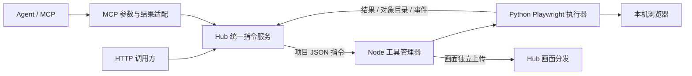

> 设计记录：0.6.0 已按本方案实施。以下保留 2026-10-18 的评审语境，正文“当前”指评审时的 0.5.x；现行字段和操作步骤以[当前文档导航](../README.md)中的手册、参考合同与架构为准。

# 工具指令执行架构改造方案

状态：已采纳并按 0.6.0 实施的设计记录。原评审日期：2026-10-18，评审基线为 Hub 0.5.1、Node 0.5.0。以下保留原方案推演；最终实现以当前架构与合同为准。

阅读顺序：本文说明目标、功能影响和实施顺序；[工具调用协议草案](工具调用协议草案.md)规定交互格式、对象引用、调用范式和错误语义。Node 内部的依赖、进程、配置和执行实现由 Node 项目的 `doc/design/Python工具执行改造方案.md` 维护。

## 1. 已确定的目标与范围

本次调整按以下要求设计：

1. Hub 负责调用方鉴权、节点和资源授权、会话与租期、请求校验、路由和结果转交；不持有 Playwright 对象，不启动 Playwright driver，不执行浏览器操作。
2. Node 使用自己的 Python 环境和 Playwright 库启动或连接浏览器，持有 Browser、Context、Page 对象，执行操作并返回结果。
3. Hub 对外提供项目自己的 HTTP 调用规则和 MCP；方法名与参数尽量遵循 Python Playwright，但只承诺动作目录中列出的能力。
4. 删除官方 SDK 的远程接入能力，不保留 `chromium.connect(Hub地址)` 或 `connect_over_cdp(Hub地址)` 的兼容层。
5. Hub 与 Node 的交互可以表达不同工具的动作。第一版只迁移 Playwright，扩展点不要求其他工具实现浏览器概念。
6. “执行对应 Python 语句”通过项目内的显式处理函数实现，例如将 `locator.fill` 映射到 `await locator.fill(value=...)`。请求不携带 Python 源码，不通过 `eval`、`exec` 或任意模块反射执行。

当前阶段只产出方案。实现、配置迁移和环境验收在方案确认后进行。

## 2. 当前事实及替换后的链路

评审时的代码有两种入口：外部官方 SDK，或 Hub 的 MCP。MCP 工具在当时的 `mcp_server.py` 和 `browser_tools.py` 中直接调用 Python Playwright；`browser.py` 通过本服务的原生入口连接远程浏览器；`native.py` 双向转发原生消息。受管理画面也由 Hub 持有的 Page 采集，实现在历史 `managed_visual.py`（0.6.0 已移除）。这些历史实现应从 Git 历史查看，不能用现行同名文件解释旧行为。

目标链路：

例如，MCP 的 `browser_fill` 将参数转换成 `tool=playwright`、`method=locator.fill` 的指令，Hub 下发给所属 Node。Node 构造 Locator 并调用 Python 方法，返回 `completed` 等 JSON 数据。Hub 不再通过官方 SDK 将这次操作转换为原生协议。

Node 仍可能由 Playwright 库启动自己的 driver 子进程，这是库的内部实现。项目不再另外安装 npm Playwright、不使用 `launchServer()`，也不获取或对外转发 Playwright 服务 WebSocket 地址。已有 Chrome 的本机 CDP 连接仍由 Node 内部使用。

## 3. 功能影响与保留边界

| 当前功能 | 改造后的处理 | 影响和验收边界 |
| --- | --- | --- |
| 登记文本、Node 身份、访问许可、撤销 | 保留凭据内容与所有者边界 | 不重新签发已有 token，不把 Node token 下发给调用方 |
| 节点主动出站、心跳、能力与资源状态 | 保留；上报工具、动作版本和资源绑定 | Node 无需开放入站浏览器端口 |
| 资源独占、会话租期、释放、断线清理 | 保留；Node 成为执行状态和对象的权威来源 | HTTP 成功或动作返回不能替代清理确认 |
| 现有 26 个 MCP 工具 | 名称、现有参数和核心结果字段以兼容为目标，逐项迁移 | 下表完整覆盖；不以工具数量相同代替行为回归 |
| `browser_start` 的 request_id、会话找回 | 保留，并扩展为通用指令关联 | 不因调用方超时重新创建浏览器或重复操作 |
| 官方 SDK 直连 Hub | 删除 | 现有 SDK 示例、握手版本检查和原生接入测试退出当前能力范围 |
| 受管理 Chromium | Python `chromium.launch()`，Node 持有对象 | Python Playwright 安装到 Node 同一虚拟环境；不依赖系统 Node.js/npm |
| 已有 Chrome、登录状态 | Node Python `connect_over_cdp(..., no_defaults=True)` | 保留明确授权的本机实例，不扫描、不启动替代浏览器、不在释放时关闭用户 Chrome |
| 受管理实时画面 | 采集迁到 Node，Hub 保留订阅与分发 | 使用执行所持有的同一 Page；切页、目标关闭和旧帧撤下必须一起迁移 |
| 已有 Chrome 可选画面采集 | 保留现有采集路线与可用性边界 | Node 内部映射页面编号和原有 CDP 目标；不能因编号改变采错页面 |
| 上传、截图、DOM 采集、弹窗、标签页 | 执行与策略迁到 Node | 保留当前限制、唯一定位和明确页面选择规则 |
| 原生 SDK 曾可使用的路由回调、Trace、下载等 | 不因底层库具备能力就自动对外开放 | 当前 MCP 没有提供的部分不作为本次保留承诺；后续有需求时单独增加动作 |
| 任意 Python/JavaScript 脚本执行 | 不增加 | 固定 DOM 采集脚本作为 Node 的实现代码迁移；不新增外部脚本入口 |
| 同机多个 Node | 保留不同身份、私有会话目录和资源独占 | 可以共享只读的浏览器安装缓存；不共用身份，不重复发布同一实际 Chrome |

官方 SDK 原生对象、异常类、回调、上传下载和文件路径的自动跨进程行为不会继续存在。新接口返回明确的 JSON、对象引用或有界二进制数据；调用方按项目规则使用，不再安装 Playwright 来连接 Hub。

### 3.1 现有 MCP 工具逐项对应

此次从当前源码提取到 26 个工具。下列是迁移清单，不是已完成的能力声明。

| MCP 工具 | 新执行位置或动作 | 必须保留的行为 |
| --- | --- | --- |
| `node_inspect` | Hub 查询已认证的 Node 能力 | 节点、资源、READY/FREE 与观测新鲜度 |
| `browser_start` | Hub 创建会话；Node 打开资源并返回初始对象 | 默认受管理 context/page、request_id 关联与失败清理 |
| `browser_sessions` | Hub 请求记录与会话索引，必要时查询 Node 状态 | 仅当前许可、按启动 request_id 找回 |
| `browser_status` | Hub 会话状态 + Node `runbridge.session_state` | 页面目录、清理状态、画面元数据 |
| `browser_stop` | Hub 释放会话，Node 关闭或断开 | 等待实际清理结论，重复释放不重复操作 |
| `browser_navigate` | Node `page.goto` | HTTP(S) 校验、DOM 就绪、url/title/http_status |
| `browser_snapshot` | Node `page.aria_snapshot` | 当前页面，最多 20000 字符与 truncated |
| `browser_fill` | Node `locator.fill` | 唯一定位，completed 只表示动作完成 |
| `browser_click` | Node `locator.click` | 唯一定位，返回当前 URL，不把点击等同业务成功 |
| `browser_read` | Node `locator.inner_text` / `locator.input_value` | 最多 20000 字符与 truncated |
| `browser_wait_for` | Node `locator.wait_for` / `runbridge.wait_for` | 状态、完整 text/value，不用固定休眠替代 |
| `browser_screenshot` | Node `page.screenshot` | PNG、视口/整页选择、最大 2 MiB、不接受远程路径 |
| `browser_inspect_dom` | Node `runbridge.inspect_dom` | 固定只读采集，最多 200 项、256 KiB JSON |
| `browser_capture` | Node `runbridge.capture` | 固定合同、同次 origin 校验、256 KiB JSON |
| `browser_press_key` | Node `page.keyboard.press` / `locator.press` | 显式目标或当前页面，不把输入和提交混成一步 |
| `browser_select_option` | Node `locator.select_option` | 按 value 选择并返回实际值 |
| `browser_check` | Node `locator.set_checked` | 明确 checked 状态并读取实际状态 |
| `browser_hover` | Node `locator.hover` | 唯一定位，保留 actionability 检查 |
| `browser_drag` | Node `locator.drag_to` | 源和目标分别唯一定位 |
| `browser_scroll` | Node `page.mouse.wheel` | 保留 delta_x/delta_y 和当前视口 |
| `browser_navigate_back` | Node `page.go_back` | 等待 DOM 就绪，返回当前 URL |
| `browser_resize` | Node `page.set_viewport_size` | 宽高范围沿用当前 MCP，不自动改变截图尺寸 |
| `browser_frames` | Node `page.frames` | frame 名称和 URL，iframe 操作仍需明确选择 |
| `browser_tabs` | Node `runbridge.tabs` | list/new/select/close，选择与画面绑定一致 |
| `browser_handle_dialog` | Node `runbridge.dialog_policy` | 先设置一次性策略再触发，无策略 dismiss |
| `browser_file_upload` | Node `locator.set_input_files` | 显式 base64 数据、合计 4 MiB、最多 32 个文件、空列表清空 |

MCP 适配层只做参数转换、公共校验和结果包装。例如 `browser_fill` 的旧 `target` 被转换成协议的 Locator 描述，`timeout_ms` 被转换成方法参数 `timeout`。唯一定位、页面操作、DOM 读取和弹窗处理均在 Node 执行。截图结果由 Hub 包装成 MCP 图像内容，不在 Hub 重新采集。

既有 MCP 稳定错误码也纳入适配，例如新执行层的 ACTION_TIMEOUT 对外继续对应 OPERATION_TIMEOUT。新增只读通用工具 `tool_request_status(session_id, request_id)` 查询指令状态；现有工具不会因为请求结果缓存失效而重新执行动作。

初版 MCP 的 `browser_start` 继续面向受管理浏览器；已有 Chrome 的操作通过新 HTTP 调用规则保留。让 MCP 同时支持借用资源是可选后续能力，不混入本次兼容目标。

### 3.2 仿照 SDK 的范围

保留 Python 风格方法名和关键字参数，例如 `page.goto` 的 `url`、`wait_until`，`locator.fill` 的 `value`，`locator.click` 的 `button`。对外返回 Page 引用或普通 JSON，不返回真正的 Playwright 对象。

第一版覆盖上表所需能力，并补齐 Browser/Context/Page 的显式创建、枚举和关闭。项目额外的固定采集、标签页和弹窗策略使用 `runbridge.*` 方法名，避免把它们伪装成官方方法。方法详细字段、返回类型、默认值和错误码要在实现时形成动作目录，HTTP 与 MCP 共用同一目录；不通过猜测 SDK 名称开放新方法。

暂不提供完整 SDK 的任意链式代理、Python 回调、网络拦截回调、原生 CDPSession、任意 evaluate、JSHandle 或 ElementHandle 跨机器引用，也不新增 Python 客户端包。需要这些功能时应明确增加项目动作，不能静默当作兼容能力。

## 4. 推荐的职责与扩展方式

### 4.1 Hub

- 复用现有登记、访问许可、资源范围、会话归属、撤销和 SQLite 存储。
- 工具能力绑定资源编号，保持现有资源级许可；同一 resource_id 不能静默改绑另一工具。`resource_ids=null` 的整节点许可沿用其覆盖节点已发布资源的语义，新增工具资源时需明确记录这一授权影响，不新增动作级 ACL。
- 新建统一指令服务：HTTP 与 MCP 最终调用同一个 `submit/query` 入口。
- 在发送前校验工具动作目录、参数、目标引用的形状、当前许可、租期、资源与协议版本；排队后再次校验。
- 持久化请求元数据与结果状态；关联响应，转交 JSON、图像和事件。不得在超时后自动重发操作。
- 保存对象目录的必要镜像用于展示、恢复和画面选页；实际对象与生存期由 Node 决定。
- 继续承载画面分发，取消 Hub 采集和 Playwright 依赖，删除 `mcp_native_url` / `--mcp-native-url` 的自连接需求。

### 4.2 Node

- 节点主进程负责身份、控制连接、会话连接、资源锁、队列和清理确认。
- 推荐沿用现有“每会话独立辅助进程”的生命周期边界，将 JavaScript 浏览器服务替换为同一 `.venv` 的 Python 工具 worker。worker 通过本地管道收发同一指令格式，内部调用 Python Playwright；不监听本机 HTTP/WS 服务。
- worker 持有对象表、页面事件、弹窗策略和画面采集任务。Node 主进程不接触 SDK 对象，只路由本项目的指令与结果。
- 受管理模式调用 `launch()`；借用模式连接所有者已配置的本机 CDP。Node 启动时探测本机实际能力，不能用包已安装代替可执行。
- 异常退出只回收本次拥有的进程与临时目录。Python 公共 API 缺少现有 BrowserServer 的 PID 接口，异常进程归属与确认方式必须先验证；确认不了则 UNKNOWN，不能推断已回收。

**进程选择的取舍：**同一 Python 进程直接执行更少一层本地通信，但浏览器驱动异常、强制停止和不同工具环境会影响节点主循环。每会话 Python worker 复用已有进程隔离边界，更适合保留心跳、异常清理和后续工具扩展，因此本方案推荐后者。第一版不增加常驻执行服务器、消息中间件或远程任务队列。

### 4.3 工具扩展

通用层只认识 `tool`、`method`、`target`、`params`、request_id、会话、结果与事件。Playwright 的 Page、Locator 和截图规则全部位于工具适配器内。

工具适配器只需提供：`describe/probe/open/execute/close`。`describe` 描述动作、输入输出、目标类型和是否可能产生副作用；`probe` 判断本机是否真正可用；其余三个方法管理本工具会话。

动作采用显式表，例如 `(playwright, locator.fill) -> 参数模型 + 执行函数`。未来接入其他 Python 库时，增加工具适配器及其动作声明，通用 HTTP 路由、请求关联和节点连接不变；需要 MCP 时再提供语义清晰的工具包装。初版采用项目内注册表，不建立插件市场、自动下载安装或通用代码执行系统。

协议信封只有一份规范。工具动作声明需要两端一致，首版采用版本化静态声明和相同契约样例校验，不依赖兄弟仓库在运行时存在，也不创建第三个仓库。是否以后拆出共享发行包，待实际复用成本出现后决定。

## 5. 连接、会话与版本迁移

### 5.1 传输

推荐保留独立控制连接与每会话执行连接。控制连接只传心跳、能力、打开、停止与清理等小消息；执行连接改传本项目的 `execute/result/event` JSON。画面继续使用独立上传连接。

不把 4 MiB 文件上传和截图结果塞进当前 64 KiB 的控制消息；会话执行仍按 16 MiB 单消息上限设计。Node 接收循环、心跳、事件、停止和画面任务不能被一个等待中的操作阻塞。每会话操作顺序执行；不同资源或 Node 可并行。

### 5.2 会话

复用 PREPARING、READY、ACTIVE、CLOSING、CLOSED、FAILED、INTERRUPTED 和 PENDING/COMPLETE/UNKNOWN 清理状态，调整触发条件：

- `PREPARING`：Node 正在打开工具资源。
- `READY`：执行连接和初始对象准备完毕，不再等待官方 SDK 接入。
- `ACTIVE`：第一条项目操作开始执行；画面和命令均绑定这次会话。
- 释放、撤销、到期或连接中断：停止接受新操作，请求 Node 关闭会话；确认不了实际清理时保持 UNKNOWN 和资源隔离。

受管理会话默认建立一个 context 和空白 page，以保留 `browser_start` 的行为；返回 Browser/Context/Page 的项目引用。借用会话只枚举原 context/page，单页可明确返回为默认页，多页由调用方选择，不通过新 context 伪装登录复用。

### 5.3 不兼容升级

- 新执行接口使用 `/v2`；控制与执行信封使用 `protocol_version=2`。当前 `/v1` 的登记、授权和凭据格式原样保留。
- 新控制入口明确协商 v2；不把 v1 透传帧当作指令解释，不提供双模式执行。
- `/v1/sessions/{id}/playwright`、`/cdp` 及其旧会话创建/查询入口在新版本不再提供原生能力，返回明确退役说明；不重定向为另一个协议。
- 不再要求调用方提交 Playwright `client_version`，SessionView 不再返回 `native_path/native_protocol`。工具版本和动作合同版本由 Node 上报并由 Hub 检查。
- MCP URL、访问凭据、既有工具名称和参数尽量保留；内部会话元数据版本升级，保留 state、cleanup、session_id、page_id 等实际使用字段。DSH 等现有消费者需做合同回归后才能宣称无需修改。
- 升级前排空旧会话；先备份 Hub SQLite，再升级两端并迁移 Node YAML。旧身份、访问 JSON 和许可记录继续使用，旧活动对象不恢复。
- SQLite 用显式迁移新增指令元数据和协议字段；历史会话保留为历史事实，不能改写成 v2 执行记录。回退须停止新会话并使用升级前数据库备份，不能用旧程序读取已经升级的库来碰运气。

## 6. 源码、配置、依赖和文档的改动范围

以下均为后续待实施范围，本次没有修改这些文件。

| Hub 区域 | 拟处理 |
| --- | --- |
| `protocol.py`、`gateway.py` | v2 控制消息、工具能力和初始引用 |
| `sessions.py`、`api.py` | 工具会话、新执行入口、租期与资源复用 |
| 新增 `commands.py` / 执行路由 | 请求校验、唯一 ID、结果关联、事件与有界缓冲 |
| `native.py` | 退出原生透传职责；新路由按指令协议处理 |
| `browser.py` | 替换为项目引用和指令服务，不保留 SDK 对象 |
| `mcp_server.py`、`browser_tools.py` | 变成薄适配，固定采集代码迁到 Node |
| `managed_visual.py` | 采集迁出；Hub 保留公开画面分发 |
| `store.py` | 显式迁移、指令元数据、状态和已有 request_id 恢复 |
| `settings.py`、`cli.py`、`app.py` | 移除 MCP 自连接配置和 Hub Playwright 启动 |
| `pyproject.toml`、锁文件 | Hub MCP extra 移除 Playwright，保留 MCP SDK |

Node 要把 Playwright 从开发依赖移为显式工具 extra，例如 `runbridge-node[playwright]`；在该 Node 的同一虚拟环境中安装。启用其他工具的部署不必安装浏览器库。删除 npm helper、npm 锁文件和 `prepare-playwright` 安装行为；不在升级时删除用户旧运行时目录。Node 详细变更、旧 launchServer 参数到 Python 参数的映射和新 YAML 在 Node 方案中单独维护。

文档迁移遵循当前职责边界：

- Hub 用户指南改成项目 HTTP 与 MCP 的操作教程，覆盖会话、引用、方法、参数、结果、事件和错误；移除官方 SDK 接入教程。
- Node 部署指南只讲本端 Python 工具依赖、浏览器要求、YAML、登记启动、多实例和清理；移除系统 Node.js/npm 要求。
- 基础工具只写要求与官网引用，不扩写 uv、Node.js 或操作系统的安装方法。
- 本机同时启动两端、完整链路测试和旧协议比对只进入开发文档。
- 历史方案与原生验收记录保留原貌，新增变更说明，不批量替换历史事实。

## 7. 分阶段实施与成功标准

| 阶段 | 实施内容 | 通过条件 |
| --- | --- | --- |
| 0：冻结契约与关键验证 | 确定本协议、动作表、Python worker 方案；小范围验证异常清理与画面同页 | 受管理正常关闭、worker/Node 异常退出、借用 Chrome 释放和弹窗等待均有明确结果；无法确认的部分不承诺 COMPLETE |
| 1：最小纵向链路 | v2 会话、worker、引用表、HTTP `page.goto` / `locator.fill` / `locator.click` / 读取、结果查询 | 独立调用方到远程 Node 的业务页面出现预期效果，调用方和 Hub 均不安装 Playwright |
| 2：迁移全部 MCP | 逐项迁移上表 26 个工具、启动找回、上传、标签页和弹窗 | 既有工具合同与代表性业务用例通过；输出内容和持久化结果有效 |
| 3：补齐现有非 MCP 能力 | 已有 Chrome 的项目 HTTP 操作、持续画面、撤销/到期/失联与结果不确定处理 | 登录状态保留；同页画面随操作变化；断线与重复 ID 不导致重复写入 |
| 4：切换与发布准备 | 移除原生代码和依赖、配置迁移、双端文档、构建与安装验证 | 新目录、新 `.venv`、本机 Hub + 虚拟机 Node 全流程不依赖 npm 运行时和旧配置；旧环境内容核验不变 |

迁移过程中可在开发分支暂时保留旧代码便于对照；最终发行物不保留官方 SDK 透传模式。

### 7.1 必须验证的关键场景

1. 无权限、其他许可、其他会话、错误对象类型和过期引用，均在动作执行前拒绝。
2. 资源忙、启动失败、版本不兼容、参数错误、唯一定位失败、页面关闭、动作超时都有可区分结果。
3. 相同 request_id、相同内容只执行一次；同 ID 不同内容冲突；结果丢失不自动重做点击、提交和上传。
4. Playwright 调用超时、调用方断线、Node 断线、Hub 重启、worker 崩溃分别验证；技术停止不等于副作用回滚。
5. 单会话排队时心跳和停止仍可处理；不同 Node 可并行；一端慢接收不会无限积压命令、结果或画面。
6. 上传输入元素拿到真实文件内容，截图可解码，固定 DOM 采集返回实际页面值；不只检查 HTTP 200。
7. 弹窗在点击前配置策略，新标签页进入 Node 对象表；多页选图、目标关闭和换代后没有旧图混入。
8. 已有 Chrome 的 cookies、localStorage、原标签页和进程在释放后保留；受管理浏览器仅回收本次资源。
9. 两个身份同时运行：会话、对象、浏览器目录和请求结果互不串用；共享安装缓存不产生身份共享。
10. 以隔离目录、隔离虚拟环境进行本机 Hub/虚拟机 Node 验收，保留命令输入、实际输出、业务结果和清理证据；不停止、不改写原测试环境。

## 8. 已知取舍

不保留官方 SDK 可以减少 npm 运行时、自连接、原生版本握手和透明对象转发的复杂度；同时，项目开始拥有动作合同，需要明确维护参数、结果和错误，而不能将库的全部能力默认算作服务能力。

每会话独立 worker、多一层有界本地管道，是为复用现有资源隔离和清理边界付出的成本。它不是对任意脚本执行的授权，也不意味着以后每个工具都必须产生浏览器对象或画面。

最需要先验证的是异常退出后的浏览器归属确认、Playwright 调用中断语义、已有 Chrome 的连接释放，以及画面迁到 Node 后的同页绑定。正常 `launch()` 和简单点击可用不能替代这些验证。

## 9. 官方依据

- [Playwright Python 异步库用法](https://playwright.dev/python/docs/library)：Node 内执行可以直接使用 Python 库；其取消任务说明指出，直接取消正在执行的 Playwright 调用会产生未定义行为。
- [Python BrowserType](https://playwright.dev/python/docs/api/class-browsertype)：受管理 `launch()` 与已有实例 `connect_over_cdp()` 是不同生命周期；后者继续只在 Node 本机使用。
- [Dialog](https://playwright.dev/python/docs/api/class-dialog)：监听弹窗后必须 accept 或 dismiss，否则可能阻塞触发弹窗的动作。

以上只支持设计依据；新架构的双端兼容、业务效果和故障恢复尚未实测。
